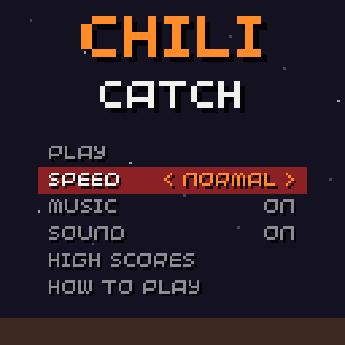
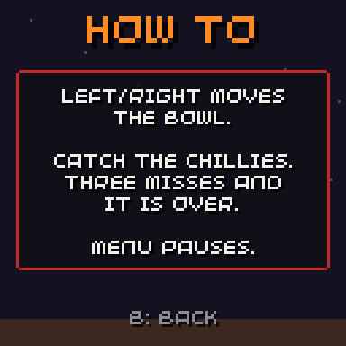
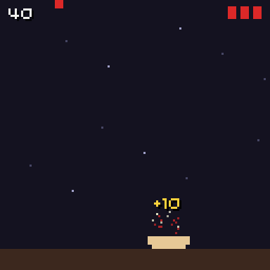
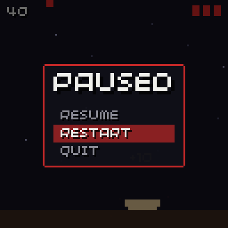
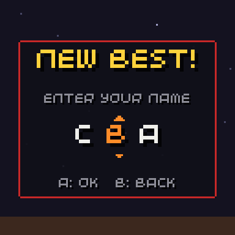
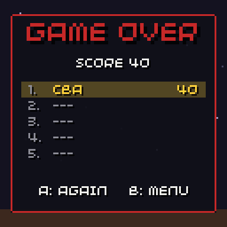
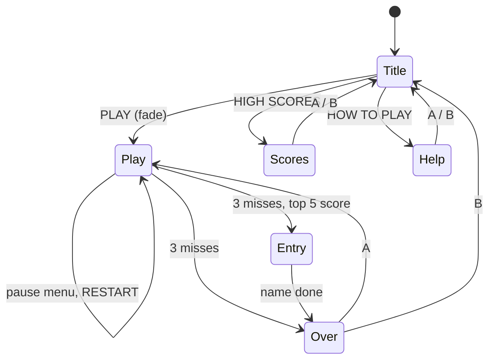

# The demo game

**Chili Catch** is a small game in [`examples/demo/demo.cpp`](https://github.com/chili-chip/chili-game-sdk/blob/main/examples/demo/demo.cpp). Move the bowl with left/right and catch the falling chillies; three misses end the round. It is about 370 lines and uses every module, so it is the quickest way to see how the parts fit.

<div class="gallery" markdown>








</div>

## Scenes



## Where each module is used

| Module | In the demo |
| --- | --- |
| [Scenes](scenes.md) | Title, Help, Scores, Play, Entry and Over are `chili::Scene`s. `guard_ms = 300`. |
| [Menu](menu.md) | Title menu (speed choice, music and sound toggles) and the pause menu. |
| [Screens](screens.md) | `TextScreen` for help, `NameEntry` for a new score, `ScoreTable` on two screens. |
| [Save and high scores](save.md) | `Save<SaveData>` with settings, the last name and a top-5 `HighScores`. |
| [Music and sound](audio.md) | Three songs, five effects, `chili::ui_sound` for menu sounds. |
| [Effects](effects.md) | A burst and a popup per catch, a shake per miss, `dim` and `panel` for pause. |
| [Input](input.md) | Through `scenes.pressed()` and `scenes.held()`. |

## Build and run it

From a checkout of this repo, next to `32blit-sdk`:

```sh
cmake -S . -B build
cmake --build build
./build/examples/demo/chili-demo
```

For the console, add the toolchain options from [Get started](getting-started.md#2-build-as-usual); the build makes `build/examples/demo/chili-demo.blit`.
