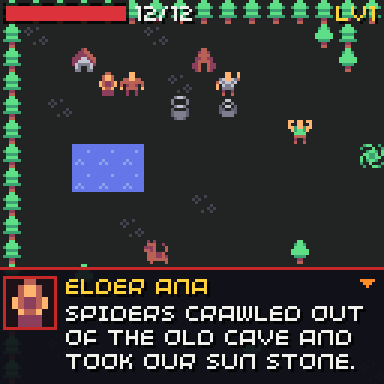
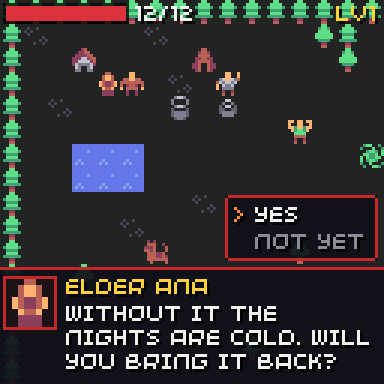

# Text box

```cpp
#include "chili/dialogue.hpp"
```

`chili::TextBox` is a dialogue box along the bottom of the screen. The RPG parts use it for [dialogue](rpg/dialogue.md), but it is part of the main `chili-game-sdk` target, so any game can use it for story text.

<div class="gallery" markdown>




</div>

It looks and behaves like the Open Sky story box in Space Fighters TURBO, with the colours of [`chili::theme`](menu.md).

| | |
| --- | --- |
| Box | The bottom 39 px of the screen, with a line along the top |
| Face | An 8x8 sprite drawn at 2x (16x16) on the left; it bobs while the text appears |
| Name | One row in gold, over the text |
| Text | Wrapped to fit, 3 lines per page, letter by letter (28 ms each) |
| Arrow | Bobs at the top right when A goes on |
| Choices | Up to 4, in a panel above the box, on the last page |

## Controls

| Button | While letters appear | When the page is shown |
| --- | --- | --- |
| A | Shows the whole page | Next page; closes the box after the last one |
| B | Shows the whole page | Nothing |
| Up / down | | Moves between choices |
| A on a choice | | Picks it and closes the box |

For the first 250 ms of each page, A does nothing, so a player still mashing does not skip text unread.

## Use it

```cpp
chili::TextBox box;
int answer = -1;

void start_scene() {
  box.say("The radio crackles. Is anyone out there?", "NOVA", 12, sheet);
  box.ask({"Answer", "Stay quiet"});
}

void update(uint32_t time) {
  if(box.active() && box.update(10)) answer = box.choice();  // -1 without choices
}

void render(uint32_t time) {
  draw_game();
  box.render(time);
}
```

| Call | Does |
| --- | --- |
| `say(text, name, face, sheet)` | Opens the box. `name` can be empty; `face < 0` or no `sheet` leaves out the face. Use `\n` for a new line. |
| `ask({...})` | Adds choices after the last page of the current text. |
| `update(dt, pressed)` | One frame. Returns true on the frame the player finishes the text. |
| `render(time)` | Draws the box when it is open. |
| `active()` | True while the box is open. |
| `choice()` | The picked choice, or -1. |
| `typing()` | True while letters are still appearing. |
| `close()` | Closes it at once. |

| Setting | Default | Meaning |
| --- | --- | --- |
| `char_ms` | `28` | Time per letter. |
| `input_delay_ms` | `250` | A is ignored this long on each page. |
| `on_letter` | none | Called every other letter, for a talking blip. |

```cpp
const chili::audio::Sfx blip = {chili::audio::SFX4, Waveform::SQUARE, 0x1800, 0x7fff, 10, 1, {{520, 12}}};
box.on_letter = [] { chili::audio::play_sfx(blip); };
```

Page turns and choices play the [UI sounds](menu.md) (`move` and `select`).

## Restyle it

Change [`chili::theme`](menu.md) for the colours: `panel` and `border` for the box, `gold` for the name, `text`, `accent` for the arrow. For a different box, override `draw_box`:

```cpp
struct ScrollBox : chili::TextBox {
  void draw_box(blit::Rect r) override {
    blit::screen.pen = blit::Pen(230, 210, 170);
    blit::screen.rectangle(r);
  }
};
```
