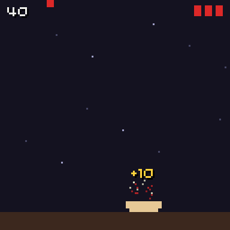

# Effects

```cpp
#include "chili/fx.hpp"
```

Particles, score popups, screen shake and drawing helpers. Everything is in `chili::fx` and draws to `blit::screen`.

{ .screenshot }

## Particles

A fixed pool of pixel particles that fly out, fall and fade.

```cpp
chili::fx::Particles particles;      // 48 particles

void on_eat(Point at) {
  particles.burst(at, Pen(235, 60, 70), 10);
}

void update(uint32_t time) {
  particles.update(10);
}

void render(uint32_t time) {
  draw_board();
  particles.render(shake.offset());
}
```

| Member | Does |
| --- | --- |
| `Particles(size_t capacity = 48)` | The pool. Set once; nothing is allocated after this. |
| `burst(Point at, Pen color, int count, const Burst &how = {})` | Throws up to `count` particles. When the pool is full, the extra ones are dropped. |
| `update(uint32_t dt)` | Moves them. |
| `render(Point offset = {0, 0})` | Draws them, moved by `offset`. |
| `clear()` | Removes them all, for example when a round starts. |
| `active()` | How many are alive. |
| `gravity` | px per ms². Default 0.00015. |

Tune a burst with `Burst`:

| Field | Default | Means |
| --- | --- | --- |
| `speed_min`, `speed_max` | 0.02, 0.07 | Speed in px per ms. |
| `lift` | 0.03 | Extra upward speed. |
| `life_min`, `life_max` | 300, 600 | Life in ms. |
| `sparkle` | `Pen(255, 255, 220)` | Half the particles take this colour. Alpha 0 turns it off. |

```cpp
chili::fx::Burst big;
big.speed_max = 0.12f;
big.life_max = 900;
particles.burst(at, gold, 40, big);
```

## Floating text

Short texts that rise and fade: "+100", "COMBO!".

```cpp
chili::fx::FloatingText popups;      // 6 at once

popups.add(at - Point(0, 6), "+100", gold);
popups.update(dt);
popups.render(shake.offset());
```

| Member | Does |
| --- | --- |
| `FloatingText(size_t slots = 6)` | How many show at once. When all are busy, the oldest is replaced. |
| `add(Point at, std::string_view s, Pen color)` | Shows up to 11 characters centred on `at`. |
| `update(dt)`, `render(offset)`, `clear()`, `active()` | Like `Particles`. |
| `life_ms`, `rise`, `fade_ms` | 700 ms, 0.02 px per ms, fades over the last 300 ms. |

Keep popups on screen by clamping `at` yourself, for example `at.x = std::clamp(at.x, 14, 114)`.

## Shake

A random offset that calms down. Add it to whatever should shake.

```cpp
chili::fx::Shake shake;

void on_hit() { shake.start(450); }

void update(uint32_t time) { shake.update(10); }

void render(uint32_t time) {
  Point o = shake.offset();
  draw_board(o);
  draw_hud();          // the HUD stays still
}
```

| Member | Does |
| --- | --- |
| `start(uint32_t duration_ms, uint32_t ms_per_px = 120)` | Shakes up to `remaining / ms_per_px + 1` pixels: 4 px at the start of a 450 ms shake, 1 px at the end. |
| `update(dt)` | Counts down. |
| `offset()` | A new random offset each call; (0, 0) when done. |
| `active()`, `stop()` | |

## Drawing helpers

| Function | Draws |
| --- | --- |
| `text(s, Point p, Pen color, TextAlign align = top_left, bool shadow = true, const Font &font = minimal_font)` | Text with a 1 px drop shadow. |
| `big_text(s, Point center, int scale, Pen color, Pen shadow = Pen(0, 0, 0, 220))` | One line scaled up 2x, 3x..., centred, with a shadow. |
| `panel(Rect r)` / `panel(Rect r, Pen fill, Pen border)` | A box with a border and cut corners. Theme colours by default. |
| `dim(uint8_t alpha, Pen color = black)` | Covers the screen. Use it behind a pause menu or to fade. |

```cpp
fx::dim(140);                                       // darken the game
fx::panel(Rect(24, 36, 80, 58));                    // box for the menu
fx::big_text("PAUSED", Point(64, 47), 2, white);    // title
fx::text("A: OK", Point(64, 96), grey, TextAlign::top_center);
```

`big_text` scales `minimal_font`, so it stays crisp on the 128x128 screen.
