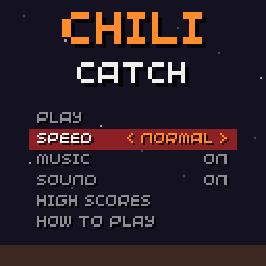
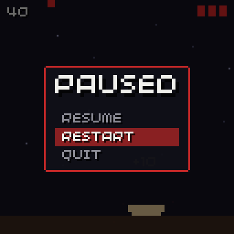
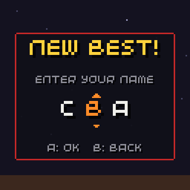
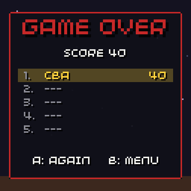
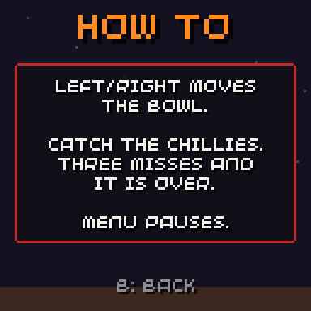
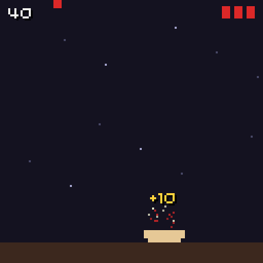
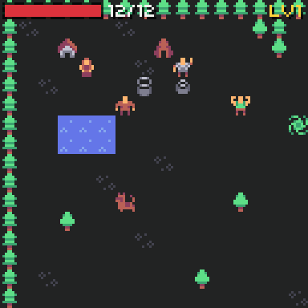
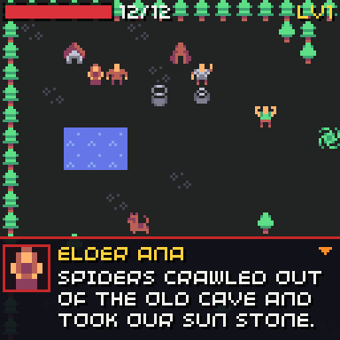
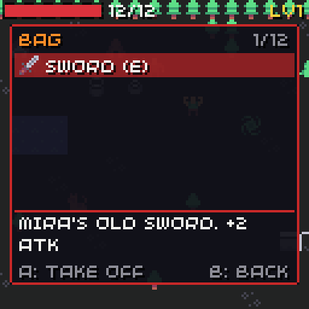
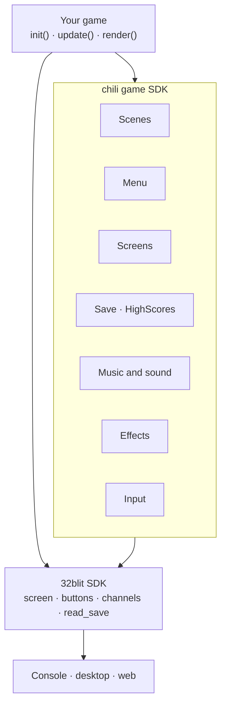

# chili game SDK

The chili game SDK is a small C++ library for **chilichip console games**. It holds the parts every game writes again: menus, scenes, saves, high scores, name entry, music, input helpers, screen effects and a text box. On top of that, the [RPG parts](rpg/index.md) play a whole turn-based RPG from one game file.

It sits on top of the [chilichip console SDK](https://sdk.chilichip.eu/), our fork of the 32blit SDK, and runs everywhere a 32blit game runs: on the console, on your computer and in the browser.

<div class="gallery" markdown>

[](menu.md)
[](menu.md#pause-menu)
[](screens.md#name-entry)
[](screens.md#score-table)
[](screens.md#text-screen)
[](effects.md)

</div>

All screenshots come from [Chili Catch](demo.md), the demo game in this repo.

## Modules

Each module is one header. Take only what your game needs: the modules do not depend on each other, except that the menu and the screens draw with the effects' text helpers.

| Module | Header | What it gives you |
| --- | --- | --- |
| [Input](input.md) | `chili/input.hpp` | `just_pressed()`, `menu_nav()`, D-pad auto-repeat |
| [Menu](menu.md) | `chili/menu.hpp` | `Menu` with action, toggle and choice rows |
| [Screens](screens.md) | `chili/screens.hpp` | `NameEntry`, `TextScreen`, `ScoreTable` |
| [Scenes](scenes.md) | `chili/scene.hpp` | `Scene` and the `Scenes` switcher, with fades and an input guard |
| [Save and high scores](save.md) | `chili/save.hpp`, `chili/scores.hpp` | `Save<T>` with magic and version, `HighScores<Entry, N>` |
| [Music and sound](audio.md) | `chili/audio.hpp` | Songs as note strings, sound effects, music and sound on/off |
| [Effects](effects.md) | `chili/fx.hpp` | Particles, floating text, shake, dim, panels, text with shadow |
| [Text box](dialogue.md) | `chili/dialogue.hpp` | A dialogue box with typewriter text, pages, a face and choices |
| Theme | `chili/ui.hpp` | Shared colours and one hook for menu sounds |

## RPG parts

A separate target, `chili-game-sdk-rpg`, adds tile maps, grid movement and turns, stats and levels, bump combat, enemy brains, a bag with equipment, dialogue, quests and saves. The whole game lives in one JSON game file, so a no-code RPG maker can write it later.

<div class="gallery" markdown>

[](rpg/index.md)
[](rpg/dialogue.md)
[](rpg/inventory.md)

</div>

Start at the [RPG overview](rpg/index.md), or play [Pepper Village](rpg/demo.md), the demo RPG.

## How it fits together

Your game keeps 32blit's `init()`, `update()` and `render()`. The SDK has no game loop of its own: you call its parts from yours.



## A taste

```cpp
#include "chili/menu.hpp"
#include "chili/save.hpp"

struct Settings {
  uint8_t speed = 1;
  uint8_t music = 1;
};

chili::Save<Settings> save(0x4b4e5332, 1);

chili::Menu title{{
  chili::Menu::action("PLAY", start_round),
  chili::Menu::choice("SPEED", {"SLOW", "NORMAL", "FAST"}, save.data.speed),
  chili::Menu::toggle("MUSIC", save.data.music),
}};

void init() {
  set_screen_mode(ScreenMode::hires);
  save.load();
  save.store_on_quit();
}

void update(uint32_t time) { title.update(); }
void render(uint32_t time) { title.render(Rect(14, 50, 100, 30)); }
```

Ready? [Add it to your game](getting-started.md).

## Not in this version

| Left out | Why |
| --- | --- |
| Volume and brightness | The console's system menu owns them. Games only have music on/off and sound on/off. |
| Real-time RPG mode | Planned in [#28](https://github.com/chili-chip/chili-game-sdk/issues/28). |
| A game loop, entities, asset loading | 32blit already does these. |

The plan and progress are in [issue #1](https://github.com/chili-chip/chili-game-sdk/issues/1), and for the RPG parts in [issue #15](https://github.com/chili-chip/chili-game-sdk/issues/15).
