# Input

```cpp
#include "chili/input.hpp"
```

Three small helpers for the input code every game writes.

!!! warning "pressed() means held"
    In 32blit, `blit::pressed(button)` is true **while the button is held**. A button that went down this frame is in `blit::buttons.pressed`. Menus that use `pressed()` skip several rows per tap. These helpers read the right one.

## Reference

| Function | Does |
| --- | --- |
| `bool just_pressed(uint32_t button)` | True on the frame the button went down. |
| `bool menu_nav(int &index, int count, uint32_t pressed = buttons.pressed)` | Up/down moves `index` in `0..count-1`, with wrap-around. True when it moved. |
| `Repeat(uint32_t delay_ms = 250, uint32_t rate_ms = 80)` | Auto-repeat for held buttons. |
| `uint32_t Repeat::update(uint32_t dt)` | Call once per update. Returns the buttons that fire this frame. |
| `uint32_t Repeat::update(uint32_t held, uint32_t dt)` | Same, with your own held buttons (for example `scenes.held()`). |
| `bool Repeat::fired(uint32_t button)` | Whether the button fired on the last update. |
| `void Repeat::reset()` | Forget held buttons, for example when a round starts. |

## just_pressed

```cpp
if(chili::just_pressed(Button::A)) jump();
```

The same as `buttons.pressed & Button::A`, with a name that says what it means.

## menu_nav

```cpp
int choice = 0;

void update(uint32_t time) {
  if(chili::menu_nav(choice, 3)) audio::play_sfx(sfx_move);
}
```

| Index | Up | Down |
| --- | --- | --- |
| 0 | 2 | 1 |
| 1 | 0 | 2 |
| 2 | 1 | 0 |

Pass your own `pressed` to filter input, for example `chili::menu_nav(choice, 3, scenes.pressed())`. For a full menu with values and actions, use [Menu](menu.md).

## Repeat

Holding a direction should move once, wait, then keep moving: like a key on a keyboard. Tetris pieces, a cursor on a board and letter pickers all want this.

```cpp
chili::Repeat repeat(200, 60);  // wait 200 ms, then every 60 ms

void update(uint32_t time) {
  repeat.update(10);  // 32blit calls update() every 10 ms
  if(repeat.fired(Button::DPAD_LEFT)) piece.x--;
  if(repeat.fired(Button::DPAD_RIGHT)) piece.x++;
  if(repeat.fired(Button::DPAD_DOWN)) piece.y++;
}
```

How it fires while a button is held (delay 200 ms, rate 60 ms):

```mermaid
gantt
    dateFormat x
    axisFormat %L ms
    section Held
    button down        :0, 440
    section Fires
    press              :milestone, 0, 0
    after delay        :milestone, 200, 200
    repeat             :milestone, 260, 260
    repeat             :milestone, 320, 320
    repeat             :milestone, 380, 380
    repeat             :milestone, 440, 440
```



- Each button is timed on its own, so holding left and then pressing down fires down right away.
- After a long frame (a stall), it fires once and skips the missed repeats, so a piece does not jump.
- Releasing the button starts the delay over.

The defaults, 250 ms then every 80 ms, feel right for menus and cursors.
