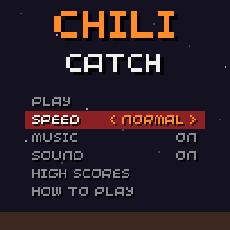
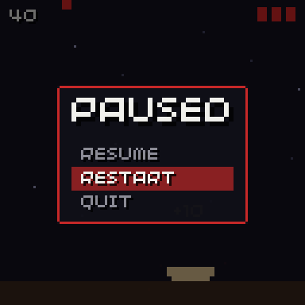

# Menu

```cpp
#include "chili/menu.hpp"
```

One `chili::Menu` class covers title menus, options menus and pause menus.

<div class="gallery" markdown>




</div>

## Rows

A menu is a list of rows. There are three kinds:

| Row | Made with | Left/right | A |
| --- | --- | --- | --- |
| Action | `Menu::action(label, fn)` | nothing | runs `fn` |
| Toggle | `Menu::toggle(label, value, on_change)` | flips the value | flips the value |
| Choice | `Menu::choice(label, {options...}, index, on_change)` | steps back / forward, with wrap | steps forward |

- A toggle writes to a `bool &` or a `uint8_t &` (0 or 1), so it can point straight at a field of your save struct.
- A choice writes the index of the option to a `uint8_t &`.
- `on_change` is optional. It runs after the value changed: store the save there, or apply the setting.

## Controls

| Button | Does |
| --- | --- |
| Up / down | Moves the cursor, with wrap-around |
| Left / right | Changes a toggle or a choice |
| A | Runs an action, flips a toggle, or steps a choice forward |
| B | Calls `on_back`, if set |

## Title menu

```cpp
#include "chili/menu.hpp"
#include "chili/save.hpp"

struct Settings {
  uint8_t speed = 1;
  uint8_t music = 1;
  uint8_t sound = 1;
};
chili::Save<Settings> save(0x48435443, 1);

chili::Menu title{{
  chili::Menu::action("PLAY", [] { scenes.go(play); }),
  chili::Menu::choice("SPEED", {"SLOW", "NORMAL", "FAST"}, save.data.speed, [] { save.store(); }),
  chili::Menu::toggle("MUSIC", save.data.music, [] { apply_settings(); save.store(); }),
  chili::Menu::toggle("SOUND", save.data.sound, [] { apply_settings(); save.store(); }),
  chili::Menu::action("HIGH SCORES", [] { scenes.go(scores); }),
  chili::Menu::action("HOW TO PLAY", [] { scenes.go(help); }),
}};

void update(uint32_t time) {
  title.update();
}

void render(uint32_t time) {
  title.render(Rect(14, 52, 100, 60));
}
```

`render(area)` draws one row every `row_height` pixels (10 by default) from the top of `area`. The width of `area` is the width of the highlight bar.

## Pause menu

The same class with three actions. `on_back` lets B close it, like MENU.

```cpp
chili::Menu pause_menu{{
  chili::Menu::action("RESUME", resume),
  chili::Menu::action("RESTART", restart),
  chili::Menu::action("QUIT", quit),
}};

void init() {
  pause_menu.on_back = resume;
}

void open_pause() {
  pause_menu.select(0);  // always start on RESUME
  paused = true;
}
```

## Reference

| Member | Does |
| --- | --- |
| `Menu(std::initializer_list<Item> items)` | Makes a menu from rows. |
| `bool update(uint32_t pressed = buttons.pressed)` | Handles one frame of input. True when something happened. |
| `void render(Rect area)` | Draws the background and every row. |
| `int selected()` / `void select(int)` | The cursor. `select` ignores an index out of range. |
| `int count()` / `const Item &item(int)` | The rows. |
| `static std::string value_text(const Item &)` | `"ON"`/`"OFF"`, the option, or `""` for an action. |
| `std::function<void()> on_back` | Called on B. |
| `int row_height` | Pixels per row. Default 10. |

A choice index out of range (say, from an old save) shows no value, and the next change brings it back into range.

## Sounds

The menu reports what happened through `chili::ui_sound`: `move` for up/down, `change` for a toggle or choice, `select` for an action and `back` for B. See [Get started: menu sounds](getting-started.md#menu-sounds).

## Restyle it

The default look uses [`chili::theme`](getting-started.md#match-your-games-look). For your own look, subclass and override one or both hooks:

| Hook | Default |
| --- | --- |
| `draw_background(Rect area)` | Draws nothing. |
| `draw_item(const Item &item, Rect row, bool selected)` | A highlight bar on the selected row, the label on the left, the value on the right, `< NORMAL >` when selected. |

```cpp
class SnekMenu : public chili::Menu {
public:
  using chili::Menu::Menu;

protected:
  void draw_item(const Item &item, Rect row, bool selected) override {
    if(selected) {
      screen.pen = Pen(70, 150, 80, 150);
      screen.rectangle(row);
      draw_snake_head(Point(row.x - 8, row.y + 2));  // points at the row
    }
    fx::text(item.label, Point(row.x + 4, row.y + 1), selected ? white : grey);
    std::string value = value_text(item);
    if(!value.empty()) fx::text(value, Point(row.x + row.w - 4, row.y + 1), gold, TextAlign::top_right);
  }
};

SnekMenu title{{ /* rows */ }};
```

Keep the `using chili::Menu::Menu;` line so the subclass takes the same list of rows.
