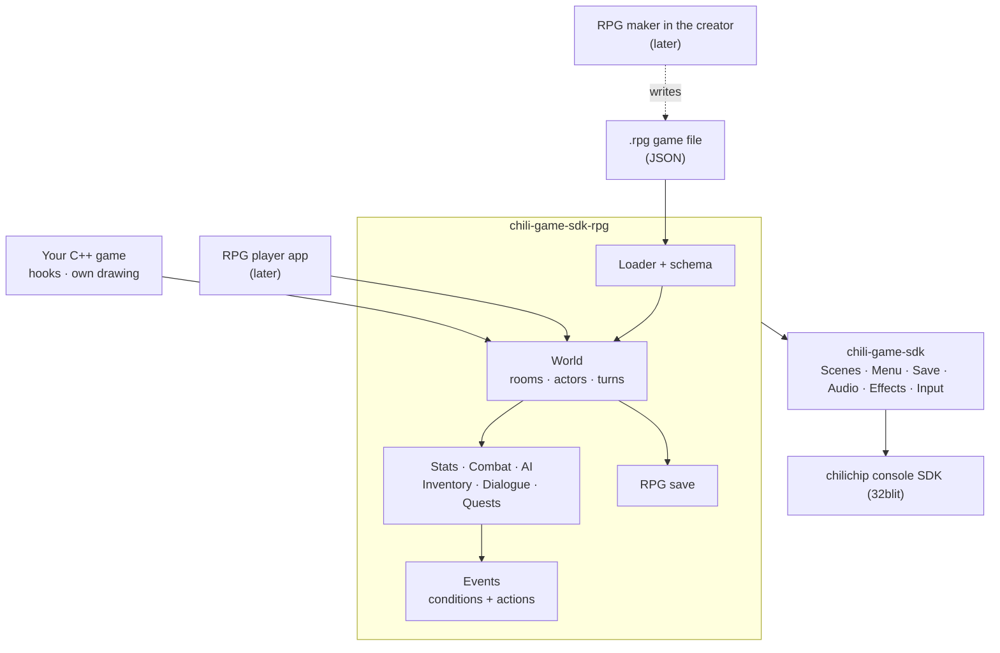
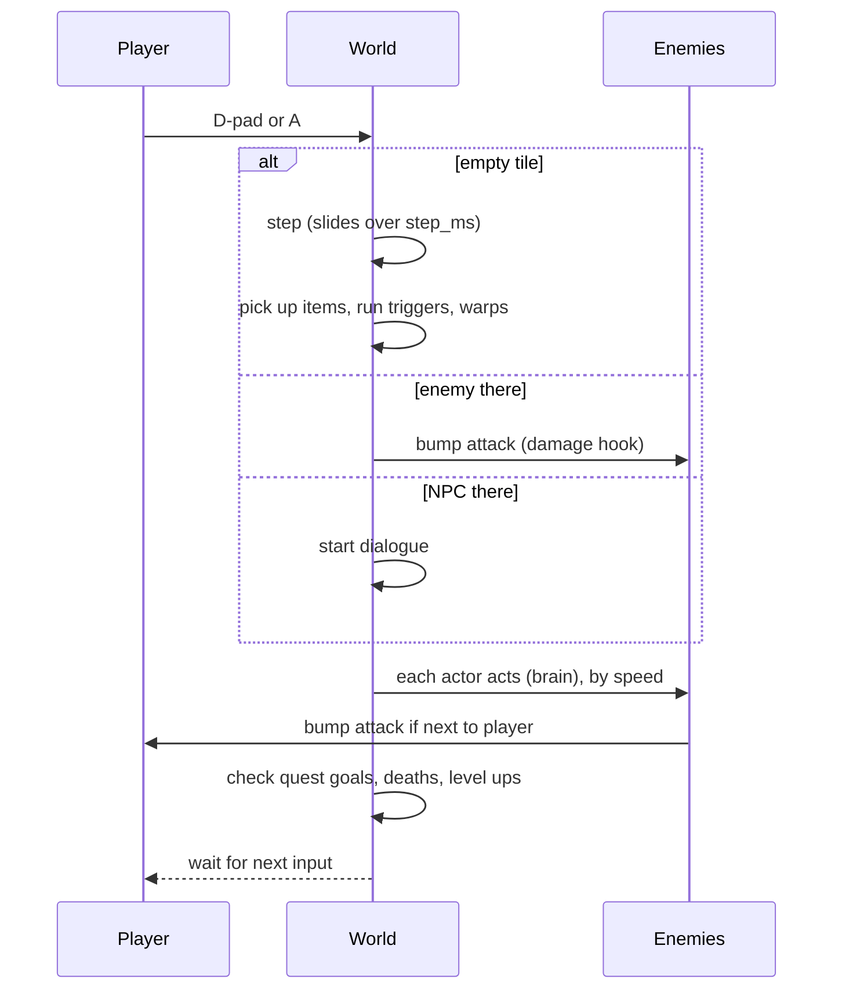
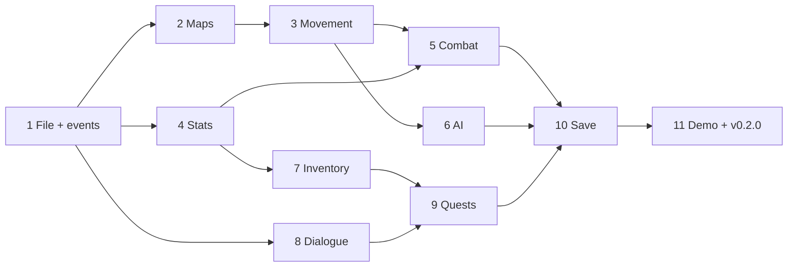

# RPG expansion: plan

!!! info "Status: plan"
    Nothing on this page is built yet. The work is tracked in [#15](https://github.com/chili-chip/chili-game-sdk/issues/15) and its sub-issues. This page changes as the parts land.

The RPG expansion adds the parts a top-down RPG needs: tile maps, grid movement, stats, inventory, bump combat, enemy AI, dialogue, quests and story. It also gets the SDK ready for a **no-code RPG maker** in the creator later.

## The short version

- **One game file holds all content.** Maps, stats, items, enemies, dialogue and quests live in one JSON file (`.rpg`). C++ only adds rules the file cannot say.
- **The maker writes the same file later.** A no-code RPG editor in the creator saves `.rpg` files, and an RPG player app on the console opens them. This is the same path [Chili Beat](https://github.com/chili-chip/chili-beat) takes today.
- **Turn-based on a grid.** You move one tile, then every enemy moves one tile. Walking into an enemy attacks it. Steps slide smoothly, so it still feels alive.
- **Customise in three layers:** the game file first, then a few C++ hooks, then your own drawing.
- **Separate CMake target.** `chili-game-sdk-rpg` links on top of `chili-game-sdk`, so arcade games do not carry it.

## How it fits together



A hand-written game and the future player app use the same `World`. The only difference is where the `.rpg` file comes from: an asset built into the game, or a file on the console's drive.

## Where we drew the line

The ask was "highly customisable". Our rule is KISS and no unrequested features. This is how the two meet.

| Layer | Who uses it | What you can change | Examples |
| --- | --- | --- | --- |
| **1. Game file** | Everyone, and later the maker | All content and most numbers | Stat names, items, equip slots, enemy kinds and brains, damage spread, XP table, dialogue, quests, triggers |
| **2. Hooks** | C++ games | A few named rules | `damage()`, `on_level_up`, `on_use_item`, custom actions by name, custom AI brains by name |
| **3. Drawing** | C++ games | How things look | `Theme` colours, `draw_tile`, your own HUD, your own screens on top |

What we leave out, on purpose:

| Left out | Why | What to use instead |
| --- | --- | --- |
| A scripting language (Lua, own VM) | Big, slow on the console, hard for a no-code editor | Events: a list of conditions and a list of actions |
| ECS or a component system | Too much structure for 32 actors per room | Plain structs |
| Real-time action combat | Clashes with bump combat and turns | A C++ game can skip the turn system and use the parts it wants |
| Turn-based battle screens (menu fights) | Not asked for, a big part of its own | Bump combat |
| Random dungeons | Not asked for | Hand-made rooms; a later issue if wanted |
| Parties, shops, crafting, magic | Not asked for | Items with events cover simple shops and spells |

Every left-out item can come back as its own issue when a game needs it.

## The game file

A short `.rpg` file looks like this (maps and pictures shortened). The real schema comes in [#16](https://github.com/chili-chip/chili-game-sdk/issues/16).

```json
{
  "format": "chili-rpg",
  "version": 1,
  "title": "Pepper Village",
  "sprites": "sheet.png",
  "start": { "room": "village", "x": 4, "y": 6 },

  "stats": [
    { "id": "hp",     "label": "HP",  "start": 10 },
    { "id": "max_hp", "label": "MAX", "start": 10 },
    { "id": "atk",    "label": "ATK", "start": 2 },
    { "id": "def",    "label": "DEF", "start": 0 }
  ],
  "levels": { "xp": [0, 10, 25, 50], "gain": { "max_hp": 3, "atk": 1 } },
  "combat": { "spread": 1, "crit": 5 },

  "tiles": [
    { "key": ".", "sprite": 0 },
    { "key": "#", "sprite": 1, "solid": true },
    { "key": "~", "sprite": [2, 3], "water": true }
  ],

  "rooms": [{
    "id": "village",
    "ground": ["################", "#..............#", "…"],
    "actors": [
      { "kind": "elder", "x": 7, "y": 3, "talk": "elder-hello" },
      { "kind": "slime", "x": 12, "y": 9 }
    ],
    "warps": [{ "x": 15, "y": 8, "to": "cave", "tx": 1, "ty": 8 }]
  }],

  "kinds": [
    { "id": "elder", "sprite": 16, "brain": "still", "friendly": true },
    { "id": "slime", "sprite": 20, "brain": "chase", "sight": 5,
      "stats": { "hp": 4, "atk": 1 }, "xp": 3, "drops": [{ "item": "jelly", "chance": 50 }] }
  ],

  "items": [
    { "id": "jelly", "name": "Slime jelly", "icon": 40, "kind": "use", "stack": 9,
      "use": [{ "heal": 3 }] },
    { "id": "stick", "name": "Stick", "icon": 41, "kind": "equip", "slot": "weapon",
      "bonus": { "atk": 1 } }
  ],
  "slots": ["weapon", "armour", "charm"],

  "dialogue": [
    { "id": "elder-hello", "who": "elder", "lines": [
      { "text": "Slimes took the well. Bring me 3 jellies?",
        "choices": [
          { "text": "Yes", "do": [{ "quest": "jelly", "stage": 1 }] },
          { "text": "Later" }
        ] }
    ] }
  ],

  "quests": [
    { "id": "jelly", "title": "Sticky well", "stages": [
      { "log": "Bring 3 jellies to the elder.",
        "goal": { "collect": "jelly", "count": 3 },
        "done": [{ "take": "jelly", "count": 3 }, { "give": "stick" }] }
    ] }
  ]
}
```

Why JSON:

- The creator and the platform already store games as text. Chili Beat uses JSON too, with a small reader that runs on the console.
- A JSON Schema lets the maker, the validator and the docs share one definition.
- C++ games can embed the file as an asset. They do not need a build step to turn it into code.

Ids (`"slime"`, `"jelly"`) turn into small numbers when the file loads. The game never compares strings while playing.

## Events: the glue

Dialogue, items, triggers, deaths and quests all run **events**. An event is a list of conditions and a list of actions. This replaces a scripting language.

```json
{ "if": [{ "flag": "well-clean" }, { "has": "key" }],
  "do": [{ "set": "door-open" }, { "sound": "unlock" }, { "say": "door-opened" }] }
```

| Conditions (v1) | Actions (v1) |
| --- | --- |
| `flag`, `not` | `set`, `clear` (flags) |
| `var` compare (`=`, `<`, `>`) | `add` (variables) |
| `has` item (count) | `give`, `take` items |
| `quest` stage | `heal`, `hurt`, `stat` change |
| `stat` compare | `warp` to room and tile |
| | `say` (start dialogue) |
| | `quest` (set stage) |
| | `sound`, `music` |
| | `save`, `end` (win or game over) |
| | `call` a C++ action by name |

`call` is the bridge to code. A C++ game registers `"open_shop"`, and the file says `{ "call": "open_shop" }`. The maker can list registered names later.

## A turn



While dialogue or a menu is open, the world does not take turns.

## Using it from C++

A sketch, not the final API. The final names come with each part.

```cpp
#include "chili/rpg/world.hpp"
#include "assets.hpp"

chili::rpg::World world;

void init() {
  set_screen_mode(ScreenMode::hires);
  world.load(asset_village_rpg);           // the .rpg file as an asset

  world.hooks.damage = [](const auto &a, const auto &d) {
    return std::max(1, a.stat("atk") * 2 - d.stat("def"));
  };
  world.hooks.actions["open_shop"] = [](chili::rpg::World &w) { shop.open(); };
}

void update(uint32_t time) { world.update(time); }
void render(uint32_t time) { world.render(time); }
```

`World` is also a `chili::Scene`, so a game can put it between a title menu and a game over screen with `Scenes::go()`.

## Fits the console

The chilichip console has a 128x128 screen, an RP2350 with 520 KB of RAM, and a D-pad with A, B, X, Y and Menu. Limits are fixed at build time, so nothing allocates while playing.

| Thing | Limit (v1) | RAM at the limit |
| --- | --- | --- |
| Tile size | 8x8 px (16x16 tiles on screen) | — |
| Tile types | 256 | 1 KB |
| Room size | 16x16 to 64x64 tiles, 2 layers | — |
| All room maps together | 48 KB | 48 KB |
| Actor kinds | 64 | 3 KB |
| Actors in the current room | 32 | 1 KB |
| Stats | 8 | — |
| Item kinds | 128 | 4 KB |
| Bag slots | 32 | — |
| Dialogue text | 32 KB | 32 KB |
| Event actions | 1024 | 8 KB |
| Flags / variables | 256 / 64 | under 1 KB |
| Quests | 32, 8 stages each | 2 KB |
| Save data | — | about 2 KB |

That is about 100 KB at the limits, and much less for a normal game. The file text is read once at load and then freed. [#26](https://github.com/chili-chip/chili-game-sdk/issues/26) checks RAM and frame time on the console.

Controls (default, changeable in the file):

| Button | Does |
| --- | --- |
| D-pad | Move, bump, choose |
| A | Talk, confirm, next line |
| B | Wait a turn, cancel, skip typing |
| X | Inventory |
| Y | Quest log |
| Menu | Pause menu (`chili::Menu`) |

## Parts and order

Each part is one issue and one pull request, with tests and a docs page.

| # | Part | Issue | Needs |
| --- | --- | --- | --- |
| 1 | Game file format, loader, flags and events | [#16](https://github.com/chili-chip/chili-game-sdk/issues/16) | — |
| 2 | Tile maps, rooms and camera | [#17](https://github.com/chili-chip/chili-game-sdk/issues/17) | 1 |
| 3 | Grid movement and turns | [#18](https://github.com/chili-chip/chili-game-sdk/issues/18) | 2 |
| 4 | Stats and levels | [#19](https://github.com/chili-chip/chili-game-sdk/issues/19) | 1 |
| 5 | Bump combat | [#20](https://github.com/chili-chip/chili-game-sdk/issues/20) | 3, 4 |
| 6 | Enemy AI | [#21](https://github.com/chili-chip/chili-game-sdk/issues/21) | 3 |
| 7 | Inventory and equipment | [#22](https://github.com/chili-chip/chili-game-sdk/issues/22) | 4 |
| 8 | Dialogue | [#23](https://github.com/chili-chip/chili-game-sdk/issues/23) | 1 (text box alone: nothing) |
| 9 | Quests and story | [#24](https://github.com/chili-chip/chili-game-sdk/issues/24) | 1, 7, 8 |
| 10 | Save the RPG state | [#25](https://github.com/chili-chip/chili-game-sdk/issues/25) | 3–9 |
| 11 | Demo RPG, rpg-template and release v0.2.0 | [#26](https://github.com/chili-chip/chili-game-sdk/issues/26) | all |



## The text box and Open Sky

Space Fighters TURBO is getting its own story text box right now (3 lines, A for next, the script kept in a data file). The SDK's text box ([#23](https://github.com/chili-chip/chili-game-sdk/issues/23)) will match that look and behaviour, and lives in its own header (`chili/dialogue.hpp`) so non-RPG games can use it. Space Fighters keeps its own box for now; we are not moving existing games onto the SDK.

## Later: the RPG maker

Not part of this plan, but the plan keeps the door open:

1. The creator gets an RPG editor next to Bitsy and Chili Beat. It saves `.rpg` files that pass the schema.
2. An RPG player app (`.blit`) opens `.rpg` files from the console's drive, like the Chili Beat player. It is the SDK's `World` with a title menu, and goes into the console factory image.
3. The platform stores `.rpg` games like other creator games.

To keep that path open, every part follows two rules:

- **Anything a player sees or a designer tunes goes in the file**, not in C++.
- **Hooks only add or replace rules.** A game made in the maker must work with no hooks set.

## Open questions

- File extension: `.rpg` or `.chili-rpg`?
- Should the RPG player app live in this repo or in its own repo, like Chili Beat's host?
- Sprite sheet: one 128x128 sheet per game (simple, fits the maker) or several?
