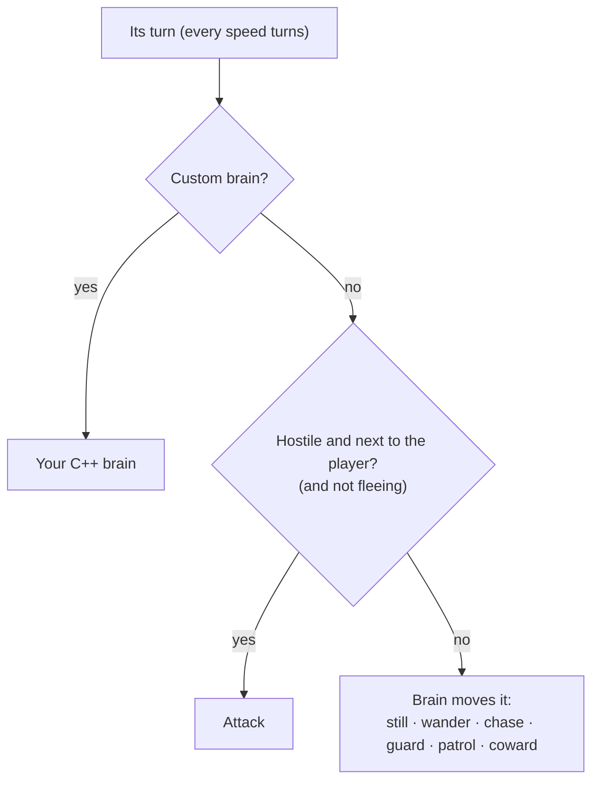

# Enemy AI

Every actor that is not the player has a **kind**. The kind says how it looks, its stats, whether it is friendly, and its **brain**: how it moves.

## Kinds

```json
"kinds": [
  { "id": "elder", "name": "Elder Ana", "sprite": 8, "friendly": true, "talk": "elder" },
  { "id": "dog", "name": "Pip", "sprite": 19, "friendly": true, "brain": "patrol", "talk": "dog" },
  { "id": "spider", "name": "Spider", "sprite": 21, "brain": "chase", "sight": 6,
    "stats": { "hp": 5, "atk": 2 }, "xp": 4 },
  { "id": "skeleton", "name": "Skeleton", "sprite": 10, "brain": "guard", "sight": 5, "home": 3,
    "stats": { "hp": 12, "atk": 3, "def": 1 }, "xp": 12,
    "drops": [ { "item": "key", "chance": 100 } ] }
]
```

| Field | Default | Meaning |
| --- | --- | --- |
| `id`, `name` | | Its id, and the name shown in dialogue. |
| `sprite`, `sprites`, `frames`, `flip` | | Its [look](game-file.md#looks). |
| `friendly` | `false` | Friendly actors are talked to, not attacked, and never attack. |
| `brain` | `still` | How it moves (below). |
| `sight` | `5` | How far it sees, in tiles. |
| `home` | `4` | How far a guard goes from its home tile. |
| `flee` | `30` | A coward runs below this percent of its max hp. |
| `speed` | `1` | Acts every 1, 2 or 3 turns. |
| `stats`, `xp`, `drops`, `death` | | See [stats](stats.md#enemy-stats) and [combat](combat.md#when-an-enemy-dies). |
| `talk`, `bump` | | What happens when the player walks into a friendly one. See [dialogue](dialogue.md#talking). |

An actor in a room can override `talk` and `bump`, and gives `patrol` points:

```json
{ "kind": "dog", "x": 6, "y": 10, "patrol": [[6, 10], [16, 10], [16, 14], [6, 14]] }
```

## Brains

| Brain | Does |
| --- | --- |
| `still` | Stays put. Attacks when the player is next to it. |
| `wander` | Takes a random step about two turns in three. |
| `chase` | When it sees the player, walks towards it on the shortest path. Otherwise waits. |
| `guard` | Chases while the player is within `home` tiles of its home, then walks back home. |
| `patrol` | Walks its `patrol` points in a loop. |
| `coward` | Chases, but below `flee` percent hp runs away from the player instead of attacking. |
| any other name | A brain your C++ game adds (below). |

Every hostile brain attacks when it starts its turn next to the player (a fleeing coward does not). Friendly actors use the same brains to walk about: the demo's villager wanders and the dog patrols.



### Seeing

An actor sees the player when the player is within `sight` tiles (counting diagonals as one) and a straight line between them crosses no `solid` tile. Water does not block sight.

### Paths

Brains that walk somewhere use a breadth-first search on the room's grid. It goes round walls, water and other actors, and looks at up to 600 tiles, so it stays fast on the console. With no path, the actor waits.

## Your own brain

Name it in the file, then register it in C++. The world calls it once per turn for each actor of that kind.

```json
{ "id": "frog", "sprite": 18, "brain": "hop", "stats": { "hp": 2 } }
```

```cpp
world.hooks.brains["hop"] = [](chili::rpg::World &w, chili::rpg::Actor &a) {
  // two tiles at a time, towards the player
  int dx = (w.player.x > a.x) - (w.player.x < a.x);
  int dy = (w.player.y > a.y) - (w.player.y < a.y);
  if(std::abs(w.player.x - a.x) + std::abs(w.player.y - a.y) == 1) {
    w.attack(a, w.player);
    return;
  }
  if(dx) dy = 0;
  if(w.step(a, dx, dy)) w.step(a, dx, dy);
};
```

A brain name with no registered code stands still, so a game file still plays in the player app.
