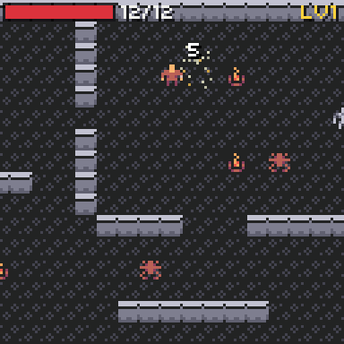

# Combat

{ width="384" }

Walk into an enemy to attack it. Enemies attack the player the same way, when they stand next to it on their turn. There are no battle screens.

## Damage

The default formula:

```text
damage = max(1, attacker atk - defender def)
then  + a random number from -spread to +spread (at least 1)
then  x 2, crit percent of the time
```

`spread` and `crit` are in the file's [rules](game-file.md#rules). `atk` and `def` include [equipment](inventory.md#equipment).

| Attacker ATK | Defender DEF | Spread 0 | Spread 1 |
| --- | --- | --- | --- |
| 2 | 0 | 2 | 1 to 3 |
| 4 | 1 | 3 | 2 to 4 |
| 1 | 3 | 1 | 1 to 2 |

## What a hit shows

- The target blinks for 300 ms.
- A number rises from it (red for the player, white for enemies).
- A small burst of particles.
- The screen shakes when the player is hit.
- Sounds: `hit` (enemy hurt), `hurt` (player hurt), `miss` (0 damage).

## When an enemy dies

1. It is gone for good: the room remembers it in the [save](save.md).
2. If a [quest](quests.md) stage wants to defeat that kind, its count goes up.
3. Each of its `drops` rolls its `chance`; drops land on its tile, and the player picks them up with A.
4. Its kind's `death` [event](events.md) runs.
5. The player gets its `xp`.

```json
{ "id": "slime", "sprite": 22, "brain": "coward",
  "stats": { "hp": 3, "atk": 1 }, "xp": 2,
  "drops": [ { "item": "potion", "chance": 30 } ],
  "death": [ { "add": "slimes", "value": 1 } ] }
```

| Drop field | Default | Meaning |
| --- | --- | --- |
| `item` | | The item id. |
| `chance` | `100` | Percent. |
| `count` | `1` | How many. |

## When the player dies

The file's top-level `lose` [event](events.md) runs. If the player still has no hp after it, the game ends and `world.result()` is `Result::lost`. So a file can bring the player back:

```json
"lose": [ { "heal": 99 }, { "warp": "village", "x": 6, "y": 5 }, { "add": "deaths", "value": 1 } ]
```

With no `lose` event, the game is simply over. Your game shows the end screen; see [Pepper Village](demo.md).

## Your own formula

```cpp
world.hooks.damage = [](chili::rpg::World &w, const chili::rpg::Actor &a, const chili::rpg::Actor &d) {
  int dmg = w.stat(a, "atk") * 2 - w.stat(d, "def");
  if(w.stat(a, "luck") > 3 && blit::random() % 4 == 0) dmg += 2;
  return std::max(0, dmg);  // 0 is a miss
};
```

The hook replaces the whole formula, spread and crits too.

From C++, `world.attack(attacker, defender)` makes one attack, and `world.hurt(actor, amount)` hurts without an attacker.
