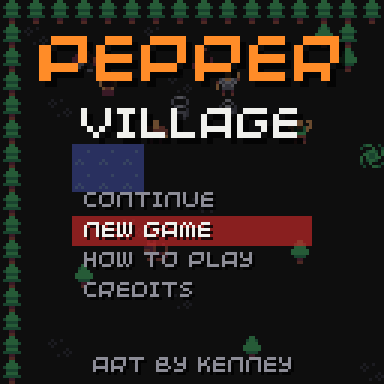
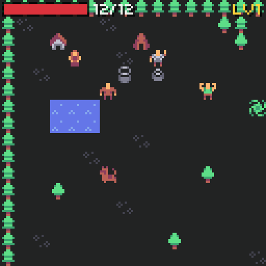
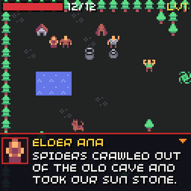
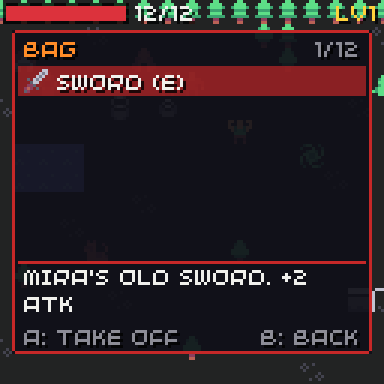
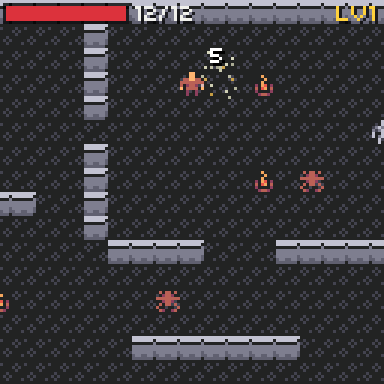
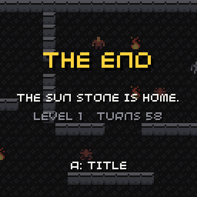

# Pepper Village

<div class="gallery" markdown>








</div>

Pepper Village is the demo RPG in [`examples/rpg`](https://github.com/chili-chip/chili-game-sdk/tree/main/examples/rpg). It uses every RPG part. All the screenshots on these pages come from it.

## The story

Spiders crawled out of the old cave and took the village's sun stone. Elder Ana asks you to bring it back.

1. Talk to Elder Ana and say yes.
2. Get a sword from Mira the smith, and put it on (X, then A).
3. Go into the cave (south east) and beat 3 spiders.
4. The skeleton guards a locked door. Beat it for the key.
5. Take the sun stone back to Elder Ana.

Green circles save the game. Fire hurts. Slimes run when they are hurt, and sometimes drop a potion.

## What is in it

| Part | In the demo |
| --- | --- |
| [Maps](maps.md) | A village (24x18, scrolls) and a cave (32x18); water, trees, fire; a warp each way; three triggers |
| [Movement](movement.md) | Step time 110 ms; the villager acts every 2 turns |
| [Stats](stats.md) | HP, MAX, ATK, DEF; 5 levels |
| [Combat](combat.md) | Spread 1, crits 10%; drops; the key from the skeleton |
| [Enemy AI](ai.md) | still (elder, smith), wander (villager), patrol (dog), coward (slime), chase (spider), guard (skeleton) |
| [Inventory](inventory.md) | Potion, sword, shield, ring, key, sun stone; three equip slots |
| [Dialogue](dialogue.md) | Lines that change with the quest, a choice, a door that talks |
| [Quests](quests.md) | One quest with four stages: talk, defeat, collect, talk |
| [Save](save.md) | Two save tiles, SAVE in the pause menu, CONTINUE on the title |

The game file is [`assets/pepper.rpg`](https://github.com/chili-chip/chili-game-sdk/blob/main/examples/rpg/assets/pepper.rpg). The C++ in [`rpg.cpp`](https://github.com/chili-chip/chili-game-sdk/blob/main/examples/rpg/rpg.cpp) only adds the title menu, a pause menu and the end screen around `World`. It sets no rule hooks.

## Build and play

```sh
cmake -S . -B build
cmake --build build --target chili-rpg-demo
./build/examples/rpg/chili-rpg-demo
```

On the console, build the `.blit` as in [Development](../development.md#build-for-the-console-and-the-web) and copy `chili-rpg-demo.blit` to the console.

The tests play the whole story with the real game file (`tests/test_rpg_demo.cpp`), so a change that breaks the demo fails CI.

## Credits

The art is [**Micro Roguelike** by Kenney](https://kenney.nl/assets/micro-roguelike) ([www.kenney.nl](https://www.kenney.nl)), licensed [CC0](https://creativecommons.org/publicdomain/zero/1.0/). Thank you, Kenney! The sheet in `examples/rpg/assets/sheet.png` is Kenney's `colored_tilemap_packed.png` with the dark background made clear. Kenney's licence file is next to it.

The demo's own credits screen names Kenney too.
