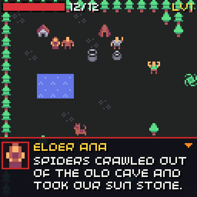
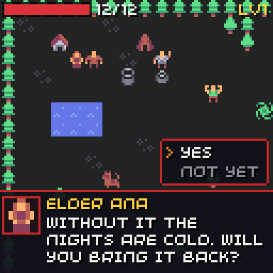
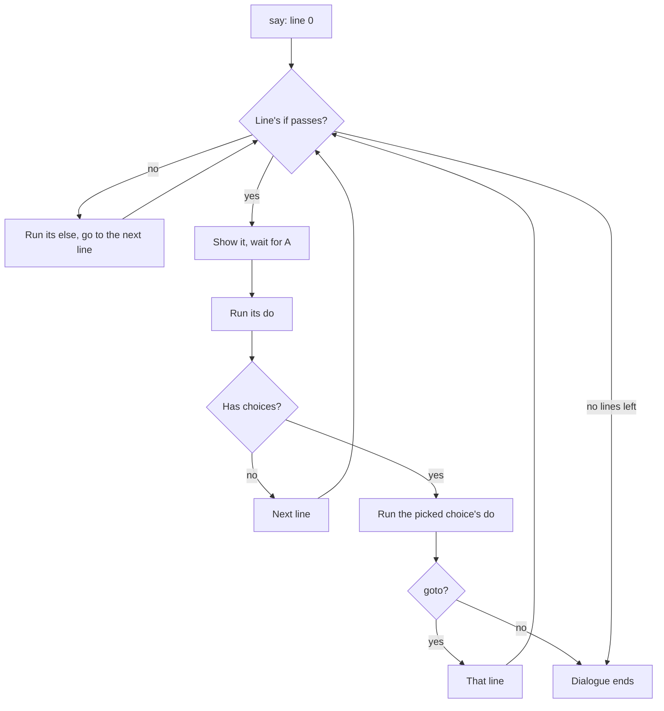

# Dialogue

<div class="gallery" markdown>




</div>

Dialogue lives in the game file and shows in the [text box](../dialogue.md). Lines can depend on the story, run actions, and offer choices.

```json
{ "id": "elder", "who": "elder", "lines": [
  { "if": [ { "quest": "stone", "stage": 0 } ],
    "text": "Spiders crawled out of the old cave and took our sun stone." },
  { "if": [ { "quest": "stone", "stage": 0 } ],
    "text": "Without it the nights are cold. Will you bring it back?",
    "choices": [
      { "text": "Yes", "do": [ { "quest": "stone", "stage": 1 } ], "goto": "go" },
      { "text": "Not yet" }
    ] },
  { "id": "go", "if": [ { "quest": "stone", "stage": 1 } ],
    "text": "Thank you! Ask Mira the smith for a sword first." },
  { "if": [ { "quest": "stone", "done": true } ],
    "text": "The village shines again, thanks to you." }
] }
```

## Dialogue fields

| Field | Meaning |
| --- | --- |
| `id` | The dialogue's id, for `talk` and the `say` action. |
| `who` | The speaker for every line. A [kind](ai.md#kinds) id shows that kind's name and its sprite as the face. Any other text is shown as is. |
| `face` | A sprite for the face. -1 for none. |
| `lines` | Up to 64 lines. |

## Line fields

| Field | Meaning |
| --- | --- |
| `text` | What is said. Long text goes on more pages by itself. |
| `id` | A name, so a choice can `goto` it. |
| `who`, `face` | Change the speaker for this line. |
| `if` | The line shows only when these [conditions](events.md#conditions) pass; otherwise it is skipped. |
| `do` | [Actions](events.md#actions) that run after the line is read. |
| `else` | Actions that run when the line is skipped. |
| `choices` | Up to 4. See below. |

## How it plays



## Choices

| Field | Meaning |
| --- | --- |
| `text` | Up to 20 characters. |
| `do` | Actions when the player picks it. |
| `goto` | The line to go on with. Without it, the dialogue ends. |

A choice can also have `if` and `else`: then `do` only runs when its conditions pass.

## Talking

The player talks to a friendly actor by walking into it, or by pressing A while facing it. Talking takes no turn.

1. A quest stage that wants to `talk` to that kind is met.
2. The actor's `talk` dialogue starts (the room's actor overrides its kind's).
3. Its `bump` event runs (again, the actor's own one first).

So a door is a friendly kind with only a `bump`:

```json
{ "id": "door", "name": "Door", "sprite": 32, "friendly": true,
  "bump": { "if": [ { "has": "key" } ],
            "do": [ { "take": "key" }, { "sound": "door" }, { "remove": true } ],
            "else": [ { "say": "locked" } ] } }
```

The world takes no turns while a dialogue is open. When it ends, [quest goals](quests.md) are checked.

## From C++

```cpp
world.say(chili::rpg::Game::find(world.game.dialogue, "elder"));
bool open = world.talking();
world.text_box().on_letter = [] { chili::audio::play_sfx(blip); };
```
