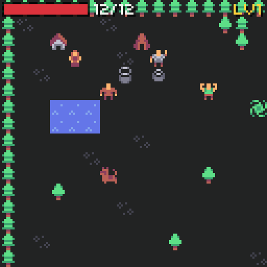
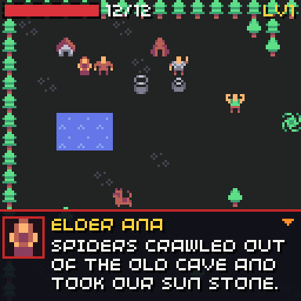
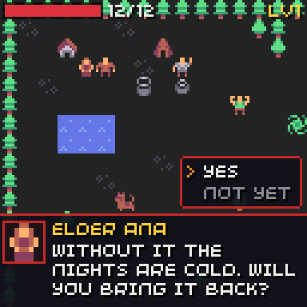
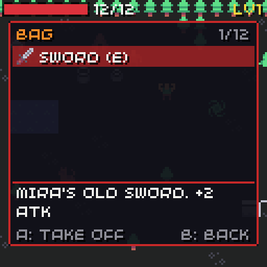
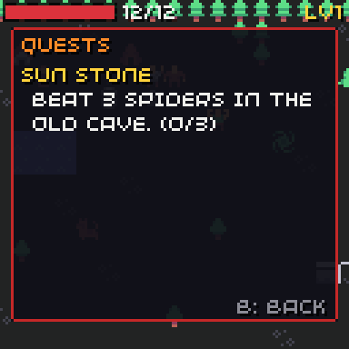
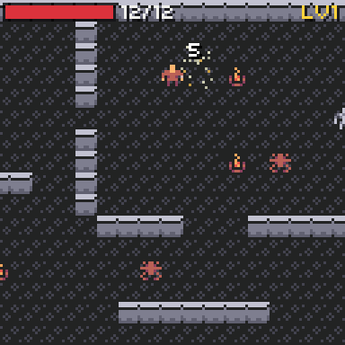
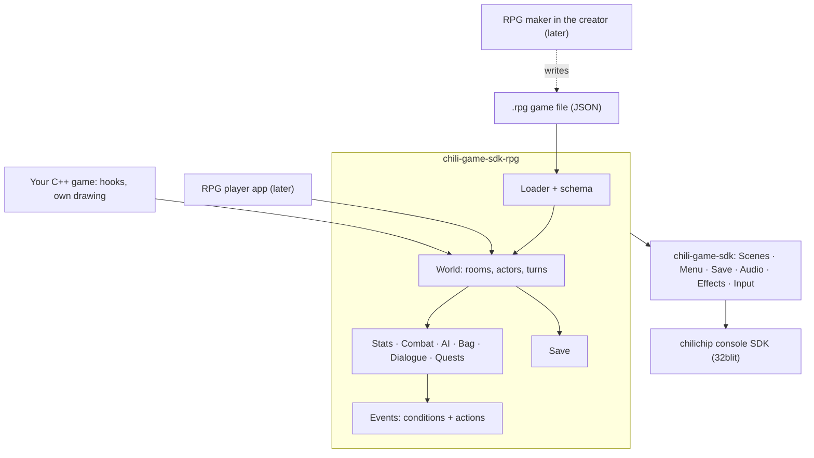
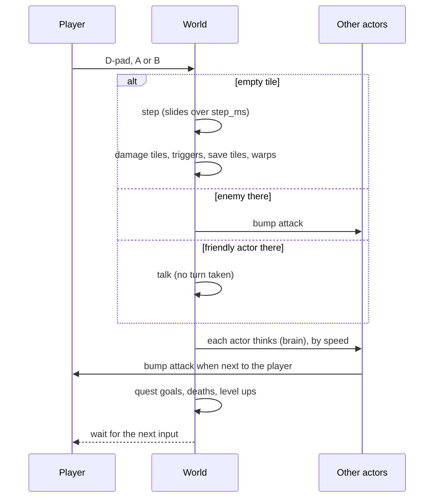

# RPG parts

```cpp
#include "chili/rpg/world.hpp"
```

The RPG parts turn a game file into a turn-based RPG on a grid: tile maps, walking, stats and levels, bump combat, enemy brains, a bag with equipment, dialogue, quests and saves.

<div class="gallery" markdown>

[](maps.md)
[](dialogue.md)
[](dialogue.md#choices)
[](inventory.md)
[](quests.md)
[](combat.md)

</div>

All screenshots come from [Pepper Village](demo.md), the demo RPG in this repo. Its art is [Micro Roguelike by Kenney](https://kenney.nl/assets/micro-roguelike) (CC0).

## One file holds the game

Everything a player sees or a designer tunes is in one JSON file, the **game file** (`.rpg`): maps, stats, items, enemies, people, dialogue and quests. C++ only adds rules the file cannot say.

This is on purpose. A no-code RPG maker in the creator will write the same file later, and an RPG player app on the console will open it. So a game made only from a file must play with no C++ at all.



## Add it to your game

The RPG parts are their own CMake target, `chili-game-sdk-rpg`, so arcade games do not carry them. Fetch the SDK as on [Get started](../getting-started.md), then link the RPG target instead:

```cmake
target_link_libraries(${PROJECT_NAME} chili-game-sdk-rpg)
```

Put the game file and a sprite sheet in your assets:

```yaml title="assets.yml"
assets.cpp:
  assets/sheet.png:
    name: asset_sheet
  assets/game.rpg:
    name: asset_game_rpg
    type: raw/binary
```

Then a whole game is this:

```cpp
#include "32blit.hpp"
#include "assets.hpp"
#include "chili/audio.hpp"
#include "chili/rpg/world.hpp"

using namespace blit;

chili::rpg::World world;

void init() {
  set_screen_mode(ScreenMode::hires);
  chili::audio::init();
  world.sheet = Surface::load(asset_sheet);
  std::string err = world.load(std::string_view((const char *)asset_game_rpg, asset_game_rpg_length));
  if(!err.empty()) debug(err + "\n");  // for example "rooms[0].actors[2].kind: no kind \"slime\""
}

void update(uint32_t time) {
  static uint32_t last = time;
  world.update(time - last);
  last = time;
  chili::audio::update(time);
}

void render(uint32_t time) {
  world.render(time);
}
```

`World` is also a [`chili::Scene`](../scenes.md), so it fits between a title menu and an end screen. [Pepper Village](demo.md) does exactly that.

## A turn

The player acts, then everyone else acts. Nothing moves while the game waits for input.



While dialogue, the bag or the quest log is open, the world does not take turns.

## Controls

| Button | Does |
| --- | --- |
| D-pad | Walk; walk into an enemy to attack, into a person to talk |
| A | Pick up what lies here, else talk to whoever you face; next line; pick a choice |
| B | Wait a turn; show the whole page of text |
| X | Bag ([inventory](inventory.md)) |
| Y | [Quest log](quests.md#the-quest-log) |
| MENU | Left to your game, usually a pause menu |

Hold the D-pad to keep walking, one tile per step.

## Three layers of customising

| Layer | Who uses it | What you can change | Examples |
| --- | --- | --- | --- |
| 1. [Game file](game-file.md) | Everyone, and later the maker | All content and most numbers | Stats, items, slots, enemy kinds and brains, damage spread, xp table, dialogue, quests, triggers |
| 2. [Hooks](hooks.md) | C++ games | A few named rules | `damage`, `on_level_up`, `on_use_item`, actions by name, brains by name |
| 3. Drawing | C++ games | How things look | [`chili::theme`](../menu.md), `draw_tile`, your own HUD and screens on top |

## The parts

| Part | Page | Issue |
| --- | --- | --- |
| Game file, loader, schema | [Game file](game-file.md) | [#16](https://github.com/chili-chip/chili-game-sdk/issues/16) |
| Flags, variables and events | [Events](events.md) | [#16](https://github.com/chili-chip/chili-game-sdk/issues/16) |
| Tiles, rooms, camera, warps, triggers | [Maps](maps.md) | [#17](https://github.com/chili-chip/chili-game-sdk/issues/17) |
| Grid movement and turns | [Movement and turns](movement.md) | [#18](https://github.com/chili-chip/chili-game-sdk/issues/18) |
| Stats, xp and levels, HUD | [Stats and levels](stats.md) | [#19](https://github.com/chili-chip/chili-game-sdk/issues/19) |
| Bump combat | [Combat](combat.md) | [#20](https://github.com/chili-chip/chili-game-sdk/issues/20) |
| Enemy brains | [Enemy AI](ai.md) | [#21](https://github.com/chili-chip/chili-game-sdk/issues/21) |
| Bag, items, equipment | [Inventory](inventory.md) | [#22](https://github.com/chili-chip/chili-game-sdk/issues/22) |
| Dialogue and the text box | [Dialogue](dialogue.md), [Text box](../dialogue.md) | [#23](https://github.com/chili-chip/chili-game-sdk/issues/23) |
| Quests and story | [Quests and story](quests.md) | [#24](https://github.com/chili-chip/chili-game-sdk/issues/24) |
| Saves | [Save](save.md) | [#25](https://github.com/chili-chip/chili-game-sdk/issues/25) |
| Demo RPG | [Pepper Village](demo.md) | [#26](https://github.com/chili-chip/chili-game-sdk/issues/26) |

## Fits the console

The chilichip console has a 128x128 screen and an RP2350 with 520 KB of RAM. The loader checks these limits, so a file that loads on your computer also fits the console.

| Thing | Limit |
| --- | --- |
| Tile size | 8x8 px, so 16x16 tiles fill the screen |
| Tile types | 90 (one character each) |
| Rooms | 32, each 16x16 to 64x64 tiles, two layers |
| All rooms together | 24,576 tiles per layer |
| Actor kinds | 64 |
| Actors, items, warps, triggers | 32 each per room |
| Stats | 8 |
| Item kinds / bag slots / equip slots | 128 / 32 / 8 |
| Flags / variables | 256 / 64 |
| Quests | 32, 8 stages each |
| Text (dialogue, item text, quest logs) | 32 KB |
| Conditions / actions | 1024 each |
| Save | under 2 KB |

The file text is read once and can be freed; the JSON reader needs about 16 bytes per value while it loads. Nothing is allocated while the game plays.

## Not in this version

| Left out | Instead |
| --- | --- |
| A scripting language | [Events](events.md): conditions and actions. `call` runs C++ when you need it. |
| Real-time mode | Planned in [#28](https://github.com/chili-chip/chili-game-sdk/issues/28). |
| Battle screens, random dungeons, parties, shops, magic | Items and events cover simple shops and spells. Each can come back as its own issue. |
