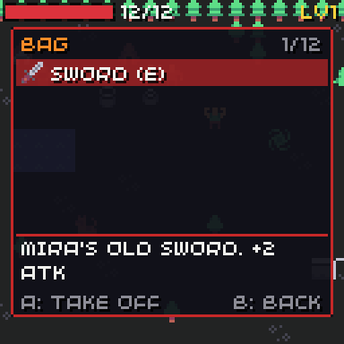

# Inventory

{ width="384" }

The player has one **bag**. Items stack in it, and equipment stays in the bag while it is worn.

## Items

```json
"slots": [ "weapon", "armour", "charm" ],
"items": [
  { "id": "potion", "name": "Potion", "text": "Heals 6 HP.", "icon": 119, "stack": 5, "use": [ { "heal": 6 } ] },
  { "id": "sword", "name": "Sword", "text": "Mira's old sword.", "icon": 62, "kind": "equip", "slot": "weapon", "bonus": { "atk": 2 } },
  { "id": "key", "name": "Rusty key", "text": "Opens a door in the cave.", "icon": 80, "kind": "key" },
  { "id": "stone", "name": "Sun stone", "icon": 78, "kind": "quest" }
]
```

| Field | Default | Meaning |
| --- | --- | --- |
| `id`, `name` | | Its id and the name shown in the bag. |
| `text` | | A short description, shown under the list. |
| `icon` | `0` | Its sprite, in the bag and on the floor. |
| `kind` | `use` | `use`, `equip`, `key` or `quest`. |
| `stack` | `1` | How many fit in one bag slot. Equipment is always 1. |
| `price` | `0` | For shops your game adds. The SDK does not use it. |
| `slot` | | For `equip`: which equipment slot. |
| `bonus` | | For `equip`: stats added while it is worn. |
| `use` | | For `use`: the [event](events.md) it runs. |

| Kind | A in the bag | Can drop |
| --- | --- | --- |
| `use` | Runs `use`, then one is used up | yes |
| `equip` | Puts it on, or takes it off | yes |
| `key` | Nothing (doors and events check for it) | no |
| `quest` | Nothing (quests check for it) | no |

A `use` event with an `if` only uses up the item when the `if` passes; its `else` can say why not:

```json
{ "id": "bomb", "icon": 112, "use": { "if": [ { "flag": "near-rock" } ],
                                      "do": [ { "set": "rock-gone" } ],
                                      "else": [ { "say": "nothing-to-blow-up" } ] } }
```

## The bag

- Its size is `bag` in the [rules](game-file.md#rules), up to 32 slots.
- New items fill stacks first, then empty slots.
- Walking over an item on the floor picks it up. When the bag is full, it stays there and "BAG FULL" shows.
- Taking items takes unequipped ones first.

## Equipment

Each slot named in `slots` holds one item. Putting on a sword takes off the sword that was on. The bonuses of everything worn add to the player's [stats](stats.md#equipment-bonuses). Taking off a `max_hp` charm lowers hp if it is now above the max.

## The bag screen

X opens it. It takes no turn.

| Button | Does |
| --- | --- |
| Up / down | Picks an item |
| A | Uses, puts on or takes off the item |
| X, then X again | Drops the item (keys and quest items cannot be dropped) |
| B | Closes the bag (X too, when it is empty) |

It draws with [`chili::theme`](../menu.md), so restyling the theme restyles the bag. `world.draw_inventory(time)` draws it; you can draw your own screen instead and call the same functions.

## From C++

```cpp
using chili::rpg::Game;
chili::rpg::Index potion = Game::find(world.game.items, "potion");

int left = world.give(potion, 3);  // how many did not fit
int took = world.take(potion, 1);  // how many it took
int have = world.count(potion);
world.use_item(0);                 // bag slot 0
world.equip(1);                    // put on, or take off
world.drop(2);
```

### `on_use_item`

Runs before an item's own `use`. Return true when you handled the item: then its event does not run and nothing is used up.

```cpp
world.hooks.on_use_item = [](chili::rpg::World &w, chili::rpg::Index item) {
  if(w.game.items[item].id != "map") return false;
  show_map = true;
  return true;
};
```
