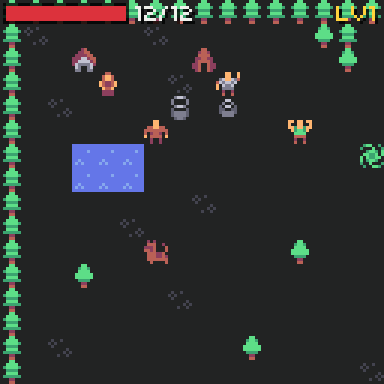

# Maps

{ width="384" }

A map is a list of **rooms**. A room is a grid of 8x8 **tiles**, drawn from a text picture: each character is one tile.

## Tiles

Each tile type has one character (its `key`) and a sprite from the sheet.

```json
"tiles": [
  { "key": ".", "sprite": 15 },
  { "key": "T", "sprite": 74, "solid": true },
  { "key": "~", "sprite": 124, "water": true },
  { "key": "S", "sprite": 113, "save": true },
  { "key": "^", "sprite": [120, 121], "frame_ms": 300, "damage": 2 }
]
```

| Field | Default | Meaning |
| --- | --- | --- |
| `key` | | One printable character, not a space. |
| `sprite` | | A sprite number, or a list of up to 4 for animation. |
| `frame_ms` | `400` | Time per animation frame. |
| `solid` | `false` | Blocks walking and sight (walls, trees). |
| `water` | `false` | Blocks walking, not sight. |
| `damage` | `0` | Hurts whoever steps on it (fire, spikes). |
| `save` | `false` | Saves the game when the player steps on it. |

## Rooms

```json
{
  "id": "village",
  "name": "Pepper Village",
  "music": "village",
  "ground": [
    "TTTTTTTTTTTTTTTTTTTTTTTT",
    "T,....,......tT...,....T",
    "T..H....h.....t.....+..T",
    "...16 to 64 rows..."
  ],
  "top": ["...same size; a space is empty..."],
  "actors":   [ { "kind": "elder", "x": 4, "y": 3 } ],
  "items":    [ { "item": "potion", "x": 21, "y": 1 } ],
  "warps":    [ { "x": 18, "y": 12, "to": "cave", "tx": 2, "ty": 2 } ],
  "triggers": [ { "x": 9, "y": 5, "if": [ { "not": "cave-seen" } ], "do": [ { "set": "cave-seen" }, { "say": "cave-dark" } ] } ]
}
```

| Field | Meaning |
| --- | --- |
| `ground` | The map, one string per row. 16 to 64 rows, all 16 to 64 characters wide and the same width. |
| `top` | A second layer, drawn over the actors (tree tops, roofs, arches). A space is empty. |
| `name` | For your own HUD. |
| `music` | A song id. It starts when the player enters the room (and keeps playing if it is already on). |
| `actors` | People, enemies and doors. See [kinds](ai.md#kinds). |
| `items` | Items lying on the floor. The player picks them up by walking over them. `count` defaults to 1. |
| `warps` | Step on `x, y` and go to room `to`, tile `tx, ty`. |
| `triggers` | Step on `x, y` and run an [event](events.md). |

Up to 32 actors, items, warps and triggers per room.

## The camera

| Room size | Camera |
| --- | --- |
| 16x16 tiles | Fills the 128x128 screen; it does not scroll. |
| Bigger | Follows the player and stops at the room's edges. |
| Smaller than the screen on one side | Sits in the middle on that side. |

`world.camera()` gives the view's top left in map pixels, for drawing your own things on the map.

## Warps

Stepping on a warp fades to black, changes room and fades in (150 ms each way). The `warp` [action](events.md#actions) does the same from an event. In C++:

```cpp
world.warp(Game::find(world.game.rooms, "cave"), 2, 2);         // with the fade
world.warp(Game::find(world.game.rooms, "cave"), 2, 2, false);  // at once
```

## Triggers

A trigger runs its event when the player steps on its tile.

| Field | Default | Meaning |
| --- | --- | --- |
| `x`, `y` | | The tile. |
| `if`, `do`, `else` | | The [event](events.md). |
| `once` | `true` | After its `do` ran once, the trigger is done for good (it is saved). |

A trigger whose `if` fails and has no `else` does nothing and stays ready.

## What a room remembers

Each room keeps three sets of bits in the [save](save.md): actors that are gone (dead or removed), floor items taken, and one-time triggers fired. So a dead enemy stays dead and a picked-up item stays picked up. Living enemies come back to their place and full health when you come back.

## Drawing tiles your way

```cpp
world.hooks.draw_tile = [](chili::rpg::World &w, uint8_t tile, blit::Point at) {
  w.draw_sprite(w.game.tiles[tile].frames[0], at);
  if(w.game.tiles[tile].water) {
    blit::screen.pen = blit::Pen(255, 255, 255, 60);
    blit::screen.rectangle(blit::Rect(at.x, at.y, 8, 2));
  }
};
```

The hook replaces the drawing of every ground and top tile. `at` is on the screen, already moved by the camera.

## Without a sprite sheet

With no `world.sheet`, the world draws a coloured square for each sprite. That is handy for a first test of a map.
