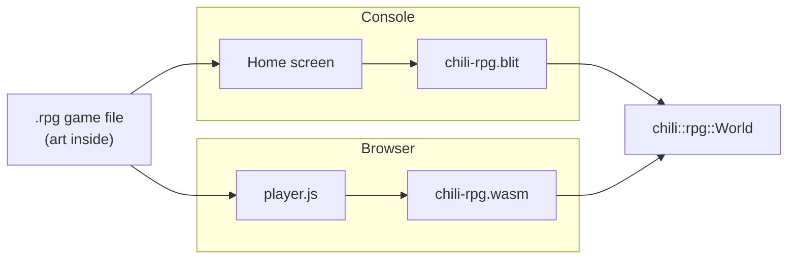
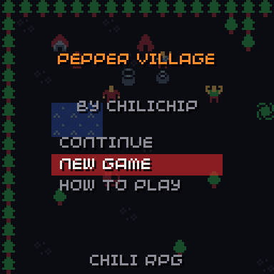
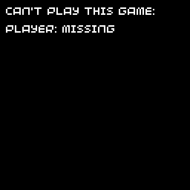
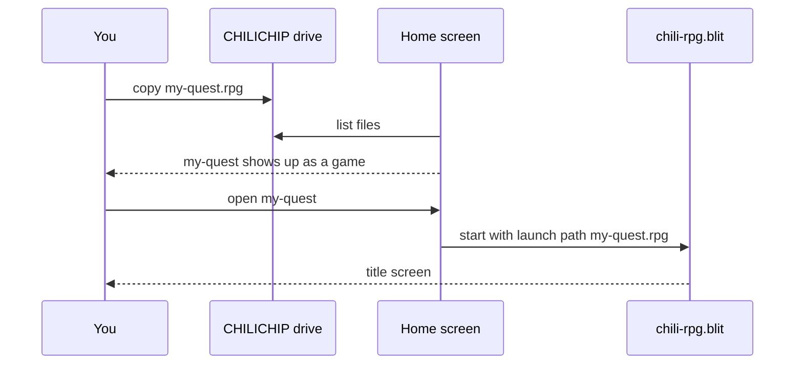
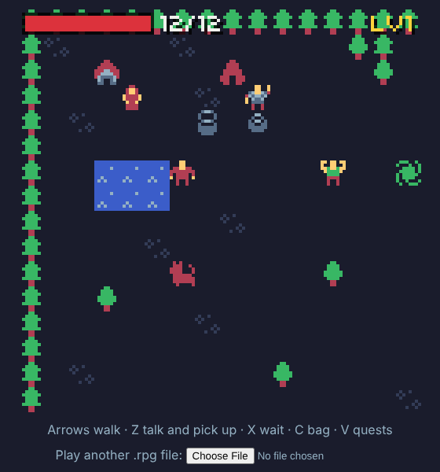

# Player apps

A game made only from a game file needs no C++. Two player apps play `.rpg` files: one on the console and one in the browser. The chili creator's RPG editor uses both.

| App | Where | Plays | Source |
| --- | --- | --- | --- |
| `chili-rpg.blit` | The chilichip console | `.rpg` files on the console's drive | [`players/rpg`](https://github.com/chili-chip/chili-game-sdk/tree/main/players/rpg) |
| `chili-rpg.js` + `.wasm` | A web page | `.rpg` text you pass in | [`players/rpg/web`](https://github.com/chili-chip/chili-game-sdk/tree/main/players/rpg/web) |

Both use the same `chili::rpg::World` as a C++ game, so a file plays the same everywhere. The game file needs its [art inside](game-file.md#art): the players load no other files.



## On the console

<div class="gallery" markdown>




</div>

`chili-rpg.blit` is a **handler app**: its `metadata.yml` says `category: handler` and `filetypes: rpg`. The console's home screen hides the app and lists every `.rpg` file on the drive as a game. Picking one starts the app with that file.



### Install

1. Get `chili-rpg.blit` from a [release](https://github.com/chili-chip/chili-game-sdk/releases), or the `chili-rpg-blit` artifact of a Build run.
2. Connect the console by USB. It shows up as a drive called **CHILICHIP**.
3. Copy `chili-rpg.blit` onto the drive. The console installs it.
4. Copy your `.rpg` games onto the drive.
5. Eject the drive. Your games are on the home screen.

Games made in the chili creator reach the console through device sync, as `.rpg` files.

### What it does

| Screen | Does |
| --- | --- |
| Title | The game's title and author over its start room. CONTINUE (with a save), NEW GAME, HOW TO PLAY. |
| Game | The world, with the [controls](index.md#controls). MENU pauses: RESUME, SAVE, QUIT. |
| End | THE END or GAME OVER, the level and the number of turns. A goes back to the title. |
| Error | When the file is broken, the loader's message, for example `rooms[0].actors[2].kind: no kind "blob"`. |

- It saves when you SAVE from the pause menu, step on a save tile, an event saves, or you quit to the home screen while playing.
- Started with no file (on a desktop build, for example), it plays Pepper Village from [`pepper-village.rpg`](demo.md).

### Build it

It builds with the rest of the SDK. The target is `chili-rpg`:

```sh
cmake -S . -B build
cmake --build build --target chili-rpg
./build/players/rpg/chili-rpg --launch_path $PWD/examples/rpg/assets/pepper-village.rpg
```

For the console, configure as in [Development](../development.md#build-for-the-console-and-the-web) and copy `chili-rpg.blit`.

## In the browser

{ width="420" }

The web player is the same world, built with Emscripten. It runs on a small stand-in for the console's firmware: a 128x128 screen in memory, buttons and a clock from JavaScript, and the 32blit sound channels mixed into samples. It has no files, so it never saves: every game starts fresh.

```js
import createChiliRpg from "./chili-rpg.js";
import { ChiliRpgPlayer, BUTTONS } from "./player.js";

const player = await ChiliRpgPlayer.create(createChiliRpg);
const error = player.load(text);   // null, or what is wrong
if (!error) player.start(canvas);  // runs until player.stop()
canvas.onclick = () => player.enableSound();
```

### Keys

| Key | Button |
| --- | --- |
| Arrows or W A S D | D-pad |
| Z, Space or Enter | A |
| X | B |
| C or I | X (bag) |
| V or Q | Y (quests) |

### The player

| Call | Does |
| --- | --- |
| `ChiliRpgPlayer.create(createChiliRpg)` | Loads the wasm. Each call makes a separate game. |
| `load(text)` | Loads a game and starts a new one. Returns `null` or the error. |
| `start(canvas, { keys })` | Plays in the canvas at 60 steps a second. Keys come from `keys` (default `window`). |
| `stop()` | Stops. |
| `restart()` | A new game from the start. |
| `step(buttons)` | One 1/60 s step with a button mask. For tests and tools. |
| `press(button, down)` | Press or release a button, for your own touch controls. A tap shorter than a step still counts. |
| `enableSound()` | Turns sound on. Call it from a click: browsers block sound before one. |
| `muted` | Set to `true` to keep it quiet. |
| `rgba()` | The screen, 128 x 128 RGBA. |
| `audio(count)` | The next `count` samples at 22050 Hz, -1 to 1. `start()` plays them for you. |
| `debug()` | What is happening, below. |
| `onStep` | Called with `debug()` after every step. |

Buttons: `up 1`, `down 2`, `left 4`, `right 8`, `a 16`, `b 32`, `x 64`, `y 128`, also as `BUTTONS.up` and so on.

### `debug()`

```json
{
  "state": "playing",
  "title": "Pepper Village",
  "room": "village", "x": 5, "y": 3,
  "level": 1, "xp": 0, "turn": 3,
  "stats": { "hp": 12, "max_hp": 12, "atk": 2, "def": 0 },
  "hp": 12,
  "talking": true, "speaker": "Elder Ana",
  "text": "Spiders crawled out of the old cave and took our sun stone.",
  "choices": [],
  "flags": ["cave-seen"],
  "vars": { "deaths": 0 },
  "quests": { "stone": 0 },
  "bag": [{ "item": "potion", "count": 1, "equipped": false }]
}
```

| Field | Meaning |
| --- | --- |
| `state` | `playing`, `won`, `lost`, or `none` before a game loads |
| `stats` | The player's stats with equipment |
| `quests` | The stage of each quest, 0 when not started, or `"done"` |
| `flags` | The flags that are on |

### Build it

You need [Emscripten](https://emscripten.org/docs/getting_started/downloads.html) (CI uses 6.0.9) and Node.

```sh
emcmake cmake -S players/rpg/web -B build-web -DCMAKE_BUILD_TYPE=Release -D32BLIT_DIR=$PWD/../32blit-sdk
cmake --build build-web --target chili-rpg
node players/rpg/web/test.mjs build-web   # plays Pepper Village a little
python -m http.server -d build-web        # open http://localhost:8000
```

`build-web` then has `chili-rpg.js`, `chili-rpg.wasm`, `player.js`, a demo page and `pepper-village.rpg`. Releases attach the first three.
