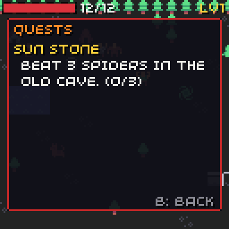

# Quests and story

{ width="384" }

A quest is a list of **stages**. Each stage has a goal and a line for the quest log. When the goal is met, the stage's `done` event runs and the next stage starts.

```json
"quests": [
  { "id": "stone", "title": "Sun stone", "stages": [
    { "log": "Get a sword from Mira the smith.", "goal": { "talk": "smith" } },
    { "log": "Beat 3 spiders in the old cave.", "goal": { "defeat": "spider", "count": 3 } },
    { "log": "Find the sun stone in the cave.", "goal": { "collect": "stone" } },
    { "log": "Bring the stone to Elder Ana.", "goal": { "talk": "elder" },
      "done": [ { "take": "stone" }, { "give": "ring" }, { "xp": 20 }, { "say": "thanks" } ] }
  ] }
]
```

Up to 32 quests, 8 stages each.

## Goals

| Goal | Met when | Example |
| --- | --- | --- |
| `talk` | The player talks to an actor of that kind during the stage | `{ "talk": "smith" }` |
| `collect` | The player has `count` (default 1) of the item | `{ "collect": "jelly", "count": 3 }` |
| `defeat` | The player beat `count` of that kind during the stage | `{ "defeat": "spider", "count": 3 }` |
| `reach` | The player stands on that room and tile | `{ "reach": "cave", "x": 27, "y": 5 }` |
| `flag` | The flag is on | `{ "flag": "well-clean" }` |
| no goal | Never by itself: an event moves the quest on | |

Goals are checked after each turn, after a dialogue ends and after an item is used. One check can finish several stages in a row (if you already carry the item the next stage wants).

## Quest state

| Stage value | Means |
| --- | --- |
| 0 | Not started |
| 1 to 8 | On that stage |
| done | Finished |

| To | Use |
| --- | --- |
| Start a quest | `{ "quest": "stone", "stage": 1 }` |
| Jump to a stage | `{ "quest": "stone", "stage": 3 }` |
| Finish it | `{ "quest": "stone", "done": true }` (or finish its last stage) |
| Check it | `{ "quest": "stone", "stage": 2 }`, `{ "quest": "stone", "done": true }` |

Starting a quest shows "NEW QUEST". A stage done plays the `quest` sound; the last one also shows "QUEST DONE".

## Story

Story is flags, variables, quest stages and [events](events.md): there is no separate story system. Some patterns:

| Want | How |
| --- | --- |
| People say new things as the story moves | Dialogue lines with `if` on quest stages or flags |
| A cut-in when you enter a place | A trigger with `if: not flag`, `do: set flag, say` |
| A gate that opens later | A friendly "gate" actor whose `bump` checks a flag, then `remove` |
| An ending | `{ "end": "win" }` in the last dialogue line |
| A counter (coins, slimes beaten) | A variable with `add`, and a `var` condition |

## The quest log

Y opens it; B or Y closes it. It lists active quests with their current log line, then finished ones. `defeat` goals and `collect` goals of more than one show a count, like "(1/3)". It takes no turn.

`world.draw_quests(time)` draws it, styled by [`chili::theme`](../menu.md).

## From C++

```cpp
chili::rpg::Index q = chili::rpg::Game::find(world.game.quests, "stone");
world.set_quest(q, 1);
world.finish_quest(q);
world.check_quests();
uint8_t stage = world.state.quests[q];  // State::DONE when finished
```
