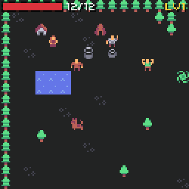

# Stats and levels

The game file names its stats. The player and every enemy share the same set.

```json
"stats": [
  { "id": "hp", "label": "HP", "start": 12 },
  { "id": "max_hp", "label": "MAX", "start": 12 },
  { "id": "atk", "label": "ATK", "start": 2 },
  { "id": "def", "label": "DEF", "start": 0 },
  { "id": "luck", "label": "LCK", "start": 1 }
]
```

| Field | Meaning |
| --- | --- |
| `id` | The stat's id. Up to 8 stats. |
| `label` | A short name (up to 4 letters) for the HUD and the bag. |
| `start` | The player's value in a new game. |

Two stats are fixed: `hp` (health now) and `max_hp`. The default [damage formula](combat.md#damage) also reads `atk` and `def`; without them it counts them as 0. Any other stat does nothing on its own: use it in [conditions](events.md#conditions) (`"stat": "luck"`) or in your own [hooks](hooks.md).

## Enemy stats

A kind gives values for the stats it needs. The rest are 0. Without `max_hp`, it is the same as `hp`.

```json
{ "id": "skeleton", "stats": { "hp": 12, "atk": 3, "def": 1 }, "xp": 12 }
```

## XP and levels

```json
"levels": { "xp": [6, 16, 32, 60], "gain": { "max_hp": 3, "atk": 1 } }
```

| Field | Meaning |
| --- | --- |
| `xp` | Total xp needed for level 2, 3, 4... Each number must be bigger than the one before. The list's length is the top level minus one. |
| `gain` | Added to the base stats at each level up. |

The player gets a kind's `xp` for each kill, and from the `xp` [action](events.md#actions). A big gain can go up more than one level at once. A level up fills hp to the new max, plays the `level` sound, shows "LEVEL UP", and calls the `on_level_up` [hook](hooks.md).

| Level | 1 | 2 | 3 | 4 | 5 |
| --- | --- | --- | --- | --- | --- |
| XP needed (demo) | 0 | 6 | 16 | 32 | 60 |
| MAX HP (demo) | 12 | 15 | 18 | 21 | 24 |
| ATK (demo) | 2 | 3 | 4 | 5 | 6 |

## Equipment bonuses

Equipped items add their `bonus` on top of the base stats (see [equipment](inventory.md#equipment)). `hp` never gets a bonus; `max_hp` can.

```cpp
int atk = world.stat(world.player, "atk");    // with equipment
int base = world.player.stats[world.game.atk]; // without
```

## The HUD

{ width="384" }

The world draws a small HUD at the top: an hp bar (it turns bright red at a quarter), the hp numbers and the level. To draw your own, turn it off and read the stats:

```cpp
world.show_hud = false;

void render(uint32_t time) {
  world.render(time);
  int hp = world.player.stats[world.game.hp];
  int max = world.stat(world.player, world.game.max_hp);
  chili::fx::text("HP " + std::to_string(hp) + "/" + std::to_string(max), Point(2, 2), chili::theme.text);
}
```

`world.draw_hud()` draws the default HUD, if you want it on top of your own things.
