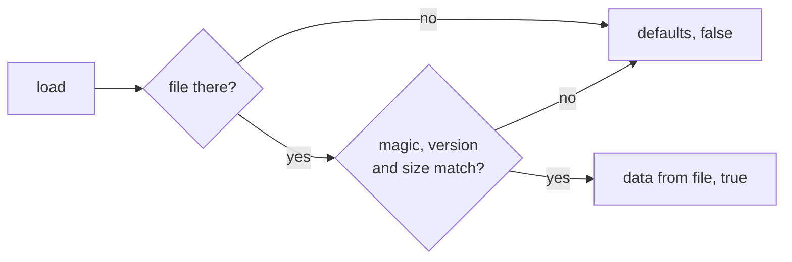

# Save and high scores

```cpp
#include "chili/save.hpp"
#include "chili/scores.hpp"
```

`Save<T>` keeps one struct in a save file. `HighScores<Entry, N>` is a top-N table that lives inside that struct.

## Save

```cpp
struct ScoreEntry {
  char name[4];
  uint32_t score;
};

struct SaveData {
  uint8_t speed = 1;          // defaults: what a new player gets
  uint8_t music = 1;
  uint8_t sound = 1;
  char last_name[4] = "AAA";
  chili::HighScores<ScoreEntry, 5> scores{};
};

chili::Save<SaveData> save(0x48435443, 1);  // magic "CTCH", version 1

void init() {
  save.load();
  save.store_on_quit();
}

void on_new_score() {
  save.data.scores.add(entry);
  save.store();
}
```

### What load() does



| Case | Result |
| --- | --- |
| First run, no save | defaults |
| A save from another game in the same slot (other magic) | defaults |
| A save from an older version (other version) | defaults |
| The struct changed size but the version did not | defaults |
| A valid save | the saved data |

!!! tip "Bump the version"
    Change the version number whenever you change `SaveData`. The size check catches most forgotten bumps, but not a change that keeps the size.

### The file

The save is the struct with an 8-byte header in front. It goes through 32blit's `write_save`, so on the console it lands in `.blit/<game title>/save0` on the USB drive and survives game updates.

| Bytes | Field |
| --- | --- |
| 0-3 | magic (`uint32_t`) |
| 4-5 | version (`uint16_t`) |
| 6-7 | `sizeof(T)` (`uint16_t`) |
| 8- | `T` |

`T` must be plain data: numbers, `char` arrays, nested plain structs. No `std::string`, `std::vector` or pointers (it will not compile). Under 64 KB.

### Moving players from an old save

When you change the format, `load()` returns false for old saves. Read the old struct yourself before giving up:

```cpp
struct OldSave { uint32_t magic; uint8_t version; /* ... */ };

void init() {
  if(!save.load()) {
    OldSave old;
    if(blit::read_save(old) && old.magic == OLD_MAGIC) {
      save.data.speed = old.speed;
      // copy the rest...
      save.store();
    }
  }
}
```

### Reference

| Member | Does |
| --- | --- |
| `Save(uint32_t magic, uint16_t version, int slot = 0)` | One save in save slot `slot`. |
| `T data` | Your data. Read and write it directly. |
| `bool load()` | Reads the save. False and defaults when not valid. |
| `void store()` | Writes `data`. |
| `void reset()` | Sets `data` back to defaults (does not write). |
| `void store_on_quit()` | Writes when the player quits: system menu, HOME, or closing the window. Sets `blit::on_quit`, so use it for one save only. |

## High scores

`HighScores<Entry, N, Order>` is a plain array of `N` entries with a few methods. Because it is plain data, it goes straight into your save struct.

`Entry` is your struct. It needs a `uint32_t score`; add anything else you want to show (name, length, level).

```cpp
struct ScoreEntry {
  char name[4];
  uint32_t score;
  uint16_t length;
};

chili::HighScores<ScoreEntry, 5> scores{};

int place = scores.rank(1200);  // 0 = best, -1 = not in the table
if(place >= 0) {
  ScoreEntry e{};
  memcpy(e.name, "KAC", 4);
  e.score = 1200;
  scores.insert(place, e);
}
```

| Member | Does |
| --- | --- |
| `int rank(uint32_t score)` | The place the score would take, or -1. 0 never ranks. |
| `void insert(int place, const Entry &e)` | Puts `e` at `place` and pushes the rest down; the last falls off. |
| `int add(const Entry &e)` | `rank` + `insert`. Returns the place, or -1. |
| `const Entry &best()` | The first entry. |
| `operator[](int)` | Any entry. |
| `size` | `N`. |

Rules:

- A score of 0 is an empty slot.
- A tie goes **below** the score that was there first.
- Ask `rank()` before name entry, and `insert()` after it, so the table does not change while the player types.

### Lower is better

For times (Minesweeper, a race), use `Order::lower_first`:

```cpp
chili::HighScores<TimeEntry, 5, chili::Order::lower_first> best_times{};
```

The smallest time is first; 0 still means empty. Draw it with a [`ScoreTable`](screens.md#show-times) that formats times.
