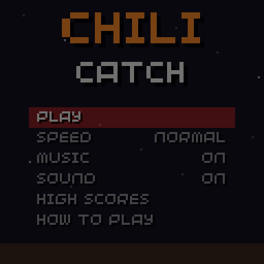
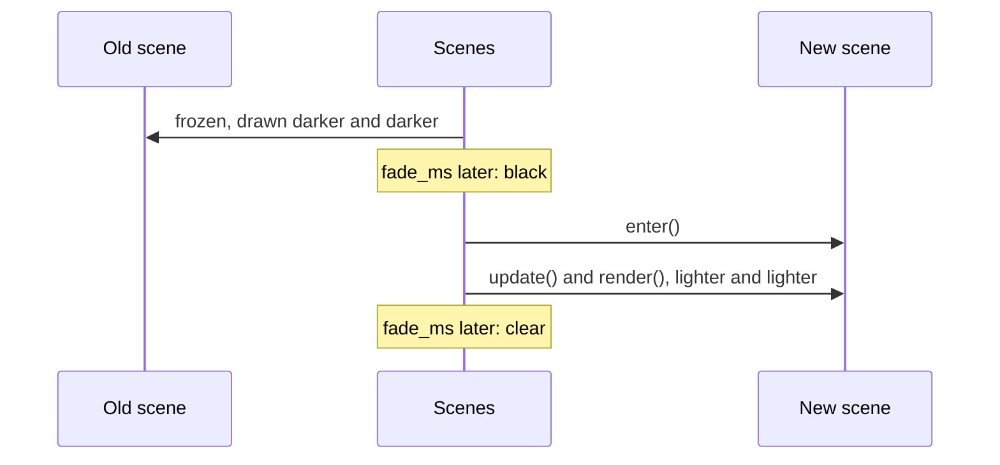

# Scenes

```cpp
#include "chili/scene.hpp"
```

Split your game into scenes: title, play, pause, game over. Each scene is a class with `enter()`, `update()` and `render()`. `chili::Scenes` runs the current one and switches between them.

This replaces the `enum class Scene` and the big `switch` in each `update()` and `render()`.

{ .screenshot }

## Example

```cpp
#include "chili/scene.hpp"

chili::Scenes scenes;

struct Title : chili::Scene {
  void enter() override { audio::play(title_song); }
  void update(uint32_t dt) override {
    if(scenes.pressed() & Button::A) scenes.go(play, 150);  // fade over 150 ms
  }
  void render(uint32_t time) override { draw_title(time); }
} title;

struct Play : chili::Scene {
  void enter() override { reset_round(); }
  void update(uint32_t dt) override { step_game(dt); }
  void render(uint32_t time) override { draw_game(time); }
} play;

void init() {
  scenes.guard_ms = 300;
  scenes.go(title);
}

void update(uint32_t time) { scenes.update(time); }
void render(uint32_t time) { scenes.render(time); }
```

Scenes are your own objects; `Scenes` only points at them, so keep them alive. Globals are fine.

## Scene

| Hook | Called |
| --- | --- |
| `virtual void enter()` | Each time the scene starts. Reset its state here. |
| `virtual void update(uint32_t dt)` | Every update, with the milliseconds since the last one. |
| `virtual void render(uint32_t time)` | Every frame, with 32blit's time in ms (for animations). |

All three are optional.

## Scenes

| Member | Does |
| --- | --- |
| `void go(Scene &next, uint32_t fade_ms = 0)` | Switches to `next`, right away or with a fade through black. |
| `void update(uint32_t time)` | Call from `update()`. |
| `void render(uint32_t time)` | Call from `render()`. Draws the scene, then the fade. |
| `Scene *current()` / `bool is(const Scene &)` | The current scene. |
| `uint32_t time_in_scene()` | Milliseconds since the current scene started. |
| `uint32_t dt()` | Milliseconds since the last update. Handy for effects. |
| `bool fading()` / `uint8_t fade_alpha()` | The fade, 0 (clear) to 255 (black). |
| `uint32_t pressed()` | This frame's presses, guarded (see below). |
| `uint32_t held()` | Held buttons, guarded. |
| `uint32_t guard_ms` | Ignore presses this long after each switch. Default 0. |
| `Pen fade_color` | Default black. |

## Fades

`go(next, fade_ms)` fades in two halves:



- The old scene stops updating while it fades out, so a dying snake does not move on.
- The new scene runs while it fades in.
- `pressed()` is 0 during the whole fade.
- Calling `go()` again during the fade-out only changes where it goes.

## The input guard

Two things go wrong when a scene changes:

1. **A button still held.** The player holds down to drop a Tetris piece; the round ends; the next round starts with the piece already dropping. `held()` and `pressed()` leave out every button that was down at the switch, until it is released.
2. **Mashing.** The player is tapping A; the game-over screen appears and the next tap skips it. Set `guard_ms` (300 to 400 ms works) and `pressed()` stays 0 that long after each switch.

So read input through `scenes.pressed()` and `scenes.held()` in your scenes, and pass them on:

```cpp
void update(uint32_t dt) override {
  menu.update(scenes.pressed());
  if(scenes.held() & Button::DPAD_LEFT) x -= speed * dt;
}
```

A pause menu inside the play scene does not need a scene of its own: keep a `paused` flag in the scene, as [Chili Catch](demo.md) does.
