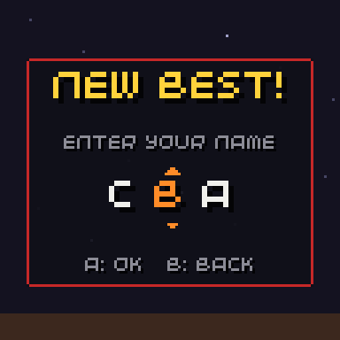
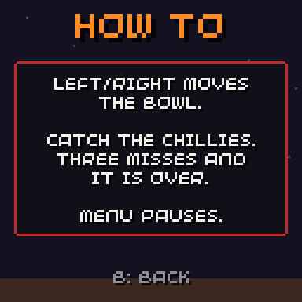
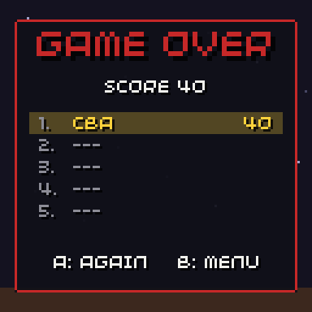

# Screens

```cpp
#include "chili/screens.hpp"
```

Ready-made screens around a game. Each draws with [`chili::theme`](getting-started.md#match-your-games-look) and has virtual hooks to restyle it.

| Class | For |
| --- | --- |
| [`NameEntry`](#name-entry) | three-letter name for a new high score |
| [`TextScreen`](#text-screen) | help and credits pages |
| [`ScoreTable`](#score-table) | drawing a [`HighScores`](save.md#high-scores) table |

## Name entry

{ .screenshot }

Arcade-style: three letters A to Z.

| Button | Does |
| --- | --- |
| Up / down | Next / previous letter, with wrap (Z to A) |
| Left / right | Moves between letters, stops at the ends |
| A | Next letter; on the last letter, done |
| B | Back one letter |

```cpp
chili::NameEntry name;

void enter_name() {
  name.start(save.data.last_name);  // players usually keep their name
}

void update(uint32_t time) {
  if(name.update()) {               // true when done
    ScoreEntry e{};
    memcpy(e.name, name.name(), 4);
    e.score = score;
    save.data.scores.insert(rank, e);
    memcpy(save.data.last_name, name.name(), 4);
    save.store();
    show_results();
  }
}

void render(uint32_t time) {
  name.render(Point(64, 74), time);  // three letters centred here, 18 px apart
}
```

| Member | Does |
| --- | --- |
| `void start(const char *last = "AAA")` | Starts over from `last`. Anything not A-Z becomes A. |
| `bool update(uint32_t pressed = buttons.pressed)` | True when the name is done. |
| `const char *name()` | The three letters, null-terminated. |
| `int cursor()` | The selected letter, 0 to 2. |
| `void render(Point center, uint32_t time)` | Draws the letters. |
| hook `draw_letter(char, Point center, bool selected, uint32_t time)` | Default: the letter at 2x, with bobbing arrows on the selected one. |

## Text screen

{ .screenshot }

A help or credits page: a title, lines in a panel and "B: BACK". A, B or MENU closes it.

```cpp
chili::TextScreen credits("CREDITS", {
  "snek v1.0.0",
  "",
  "Game: TeriyakiGod",
  "Made with 32blit",
  "chilichip.eu",
});

void update(uint32_t time) {
  if(credits.update()) go_to_title();
}

void render(uint32_t time) {
  draw_background(time);
  credits.render(time);
}
```

| Member | Does |
| --- | --- |
| `TextScreen(const char *title, {lines...})` | Makes the page. |
| `bool update(uint32_t pressed = buttons.pressed)` | True when closed. Plays `UiSound::back`. |
| `virtual void render(uint32_t time)` | Draws the page. Override it for your own layout. |
| `title`, `lines`, `line_height` | Change them any time. `line_height` is 8 by default. |

Eight to nine lines fit on the 128x128 screen with the default layout.

## Score table

{ .screenshot }

Draws any [`HighScores`](save.md#high-scores) table, one row per slot. The row at `highlight` (the score just added) blinks.

```cpp
chili::ScoreTable table;

void render(uint32_t time) {
  table.render(save.data.scores, Rect(12, 46, 104, 45), new_rank, time);
}
```

Entries need `char name[4]` and `uint32_t score`. Empty slots (score 0) show `---`.

| Member | Does |
| --- | --- |
| `render(const HighScores<...> &table, Rect area, int highlight = -1, uint32_t time = 0)` | Draws the rows from the top of `area`. |
| `int row_height` | Pixels per row. Default 9. |
| hook `std::string score_text(uint32_t score)` | How a score reads. Default: the number. |
| hook `draw_row(int place, const char *name, uint32_t score, Rect row, bool highlight, uint32_t time)` | One row. `name` is `nullptr` for an empty slot. |

### Show times

For a lower-is-better table of times, override `score_text`:

```cpp
class TimeTable : public chili::ScoreTable {
public:
  std::string score_text(uint32_t ms) const override {
    char buf[8];
    snprintf(buf, sizeof(buf), "%lu:%02lu", ms / 60000, ms / 1000 % 60);
    return buf;
  }
};
```

### Add a column

Override `draw_row`, call the default, then draw your column. The place tells you which entry it is:

```cpp
class SnekTable : public chili::ScoreTable {
protected:
  void draw_row(int place, const char *name, uint32_t score, Rect row, bool hl, uint32_t time) override {
    chili::ScoreTable::draw_row(place, name, score, Rect(row.x, row.y, row.w - 20, row.h), hl, time);
    if(name) fx::text(speed_tag(save.data.scores[place]), Point(row.x + row.w - 4, row.y + 1), dim, TextAlign::top_right);
  }
};
```
